<div align="center">


<p><b>Hand your phone one sentence — it finishes the job itself.</b></p>

<p>
  <a href="https://github.com/xkx121029/Phtomt/actions/workflows/android-ci.yml"></a>
  <a href="https://github.com/xkx121029/Phtomt/releases"></a>
  <a href="LICENSE"></a>
  <a href="https://github.com/xkx121029/Phtomt/wiki"></a>
  <a href="https://xkx121029.github.io/Phtomt/"></a>
</p>

<p>
  
  
  
  
  
</p>

<p>
  <a href="https://xkx121029.github.io/Phtomt/">Website</a> ·
  <a href="promo/app.html">Offline UI replica</a> ·
  <a href="https://github.com/xkx121029/Phtomt/wiki">Wiki</a> ·
  <a href="CHANGELOG.md">Changelog</a>
</p>

<p>
  <a href="README.md">简体中文</a> · <b>English</b>
</p>

</div>

---

Happy Agent is an AI agent that runs on Android. Say "mark all my WeChat messages as read" or "order me some takeout", and it observes the current screen, plans the steps, decides where to tap and what to type, and gets the job done within the permissions you granted.

Two hard boundaries separate it from the usual "remote-controlled AI" approach:

> **System-permission code does not live in the main app.** Accessibility, the embedded Shizuku server, and Termux — all three capability channels live in a separate Provider APK, driven from the main app over AIDL. Permissions collapse into one process you can audit on its own.

> **The AI writes no commands, computes no coordinates, and picks no channel.** It emits one of 65 semantic intents; coordinate math, command assembly, and channel selection all happen end-side in the translation layer, so the model can be swapped freely.

<details open>
<summary><b>📑 Contents</b></summary>

| Getting started | In depth |
|---|---|
| [📌 At a glance](#-at-a-glance) | [⚙ Core mechanisms](#-core-mechanisms) |
| [✨ Highlights](#-highlights) | [Three-shape routing](#three-shape-routing) · [Intent and capability registry](#intent-and-capability-registry) · [Action modes](#action-modes) |
| [🚀 Quick start](#-quick-start) | [The ReAct loop](#the-react-loop) · [Provider and execution channels](#provider-and-execution-channels) |
| [Requirements](#requirements) · [Build](#build) | [Vision pipeline](#vision-pipeline) · [Prompts](#prompts) · [Memory](#memory) |
| [Quality gates](#quality-gates) · [Optional build modules](#optional-build-modules) | [Coding environment and coding agent](#coding-environment-and-coding-agent) · [Safety](#safety) |
| [🧱 Tech stack](#-tech-stack) | [🖼 Screens](#-screens) · [🔧 Configuration](#-configuration) · [🚪 Entry points](#-entry-points) |
| [🗺 Architecture](#-architecture) | [📚 Documentation](#-documentation) · [🤝 Contributing](#-contributing) · [📄 License](#-license) |

</details>

## 📌 At a glance

| | |
|---|---|
| **Shape** | Native Android app (Kotlin + Compose), 14 Gradle modules |
| **Size** | 356 Kotlin files and 91,003 lines in the main module; 1,287 `@Test` cases |
| **Capability model** | 65 intents across 4 risk tiers → 37 actions, 3 execution channels |
| **Model needs** | Any OpenAI-compatible endpoint; defaults to `glm-4.7-flash`, no mandatory cloud |
| **Requirements** | Android 8.0+ (API 26), no root, no separate Shizuku install |
| **Docs** | `docs/` is authoritative; the [Wiki](https://github.com/xkx121029/Phtomt/wiki) is the public portal |

## ✨ Highlights

| Capability | In one line |
|---|---|
| 🧭 **Three-shape routing** | Every input is classified as phone control / coding delegation / plain chat first, so a "hello" never boots the whole perception loop |
| 🎯 **The AI only names intents** | 65 intents → 37 internal actions; coordinates, commands, and channels are all decided end-side |
| 🔐 **Three authorization tiers** | Action mode governs "may the AI ask for this", channel mode governs "can the device do it" — orthogonal |
| ⚡ **On-device-first decisions** | Dialogs, loading screens, and ads are handled locally instead of burning cloud quota |
| 👁 **Multi-source vision** | On-device 3B (GGUF + JNI), a cloud vision model, and ML Kit Chinese OCR are picked by page complexity |
| ✅ **Verified execution** | Page fingerprints are compared before and after, separating "delivered" from "actually took effect" |
| 💻 **Coding inside the phone** | PRoot + Alpine + JDK + Gradle + SDK set up in one flow, then `assembleDebug` on the device |
| 🧠 **Long tasks stay on track** | Task memory, checkpoints, circuit breakers, template reuse, plus mid-run disconnect detection and read-only sensitive pages |

## 🚀 Quick start

### Requirements

- Android Studio Hedgehog or newer
- JDK 17 (`compileOptions` and `kotlin.jvmTarget` are both 17)
- Android SDK 36
- An Android 8.0+ phone (minSdk 26)
- **No** separate Shizuku install: the server ships inside the Provider APK

### Build

```bash
git clone https://github.com/xkx121029/Phtomt.git
cd Phtomt

./gradlew :app:syncProviderAssets :app:syncEnvAssets   # required on a fresh clone, see below
./gradlew :app:assembleDebug
# output: app/build/outputs/apk/debug/app-debug.apk
```

The version number has exactly one source of truth, [version.properties](version.properties), and both `:app` and `:provider` read it: `versionCode = buildNumber`, `versionName = "0.2.$buildNumber"`. Precedence is `-PbuildNumber=NN` (CI injects `github.run_number`) > the recorded value > git commit count. Only tasks that actually produce an APK (`assemble` / `bundle` / `build`) bump and write it back; running detekt or tests does not consume a version number.

### Sync the sub-components after cloning

Provider and the coding environment are each a **separate APK**. `*.apk` is globally ignored and never committed, so a fresh clone has no execution channels until you sync:

| Situation | Command | If you skip it |
|---|---|---|
| Fresh clone | both | `assets/` holds only `version.txt`; every channel is dead on device |
| Changed `provider/` · `provider-api/` | `:app:syncProviderAssets` | The build **fails outright**: `mergeAssets` compares source fingerprints (the `.sha256` files under [config/provider-assets/](config/provider-assets/)) |
| Changed `env/` · `env-api/` | `:app:syncEnvAssets` | The build passes, but ships the old component and lags at runtime |

`provider-api` and `env-api` compile into the main app, so an out-of-sync contract is a compile error.

### Install and configure

```text
1. Install the APK, then follow the in-app guide to install the "service component"
   (Provider), which bundles the accessibility service and the Shizuku server.
2. Grant permissions: Accessibility service (required)
                      overlay / notification access / screen recording / battery whitelist (optional)
3. Settings → AI access → Cloud models: enter the endpoint and key, then "Test connection"
4. Settings → Device access → Permissions & channels: run the "channel self-check"
```

> [!TIP]
> The self-check splits "installed? → enabled? → bound? → can the tree be read? → can a screenshot be taken? → Termux in three steps" into observable steps and reports a real number at each one (version, byte count, element count). Passing it before the first task beats debugging afterwards.

If model configuration is incomplete the task **never starts** — you get a "go configure" entry instead of a runtime failure halfway through.

### Quality gates

```bash
./gradlew :app:detekt                       # static analysis (rules in config/detekt/detekt.yml)
./gradlew :app:checkDetektBaseline          # baseline may only shrink; wired into check
./gradlew :app:checkDetektBaselineBreakdown # category totals must equal the overall count
./gradlew :app:testDebugUnitTest
./gradlew :app:checkPureLogicCoverage       # pure-logic coverage may not regress
./gradlew :app:lintDebug
```

Three things worth knowing:

- **The baseline tracks more than a total.** Clearing 100 long lines and fixing one god class look identical in a single number, so [baseline-breakdown.txt](config/detekt/baseline-breakdown.txt) records the rule distribution. Of the current 1,543 entries, `MaxLineLength` (482) plus `MagicNumber` (433) account for 59%; the structure-revealing `LongMethod` / `CyclomaticComplexMethod` / `LargeClass` total roughly 12%.
- **Coverage thresholds apply to pure-logic packages only.** The bulk of this codebase depends on accessibility, Shizuku, and overlays, which only run on a real device; a global threshold would just force meaningless tests. Each threshold is the measured value, used to **prevent regression**, not as a goal: `domain/rules` 85%, `core/text` 87%, `engine/execution` 45%, `device/ops` 17% (mostly shell command assembly, unreachable from the JVM).
- **`detekt` is still `continue-on-error` in CI.** A batch of post-baseline findings remains (the count moves with commits); it becomes blocking once cleared. The baseline guard itself is a hard block.

CI ([android-ci.yml](.github/workflows/android-ci.yml)) runs the full gate on PRs and pushes to main, in order: detekt → baseline guard → baseline breakdown → unit tests → coverage → coverage gate → lint → `assembleDebug`.

### Optional build modules

Beyond the default Android build there are four optional module groups, toggled in [config/build-modules.properties](config/build-modules.properties). Their tasks are not wired into `build` / `check` / `assemble`, so enabling or disabling them never changes the default task graph or build time.

| Module | Switch | Default | Tasks |
|---|---|---|---|
| Android platform | `hpa.modules.android.enabled` | on | `androidCheck`, `androidPackage` |
| Vue dev server | `hpa.modules.vue.enabled` | off | `vueCheck`, `vueInstall`, `vueDev`, `vueBuild` |
| Git toolchain | `hpa.modules.git.enabled` | off | `gitCheck`, `gitStatus`, `gitInfo` |
| GitHub link & sync | `hpa.modules.github.enabled` | off | `githubCheck`, `githubLink`, `githubSync` |

`./gradlew buildModules` prints the switches and preconditions, `./gradlew buildModulesCheck` validates only the enabled ones, and `-Phpa.modules.<module>.enabled=true` overrides a switch for one run. The full matrix is in [docs/build-modules.md](docs/build-modules.md).

## 🧱 Tech stack

| Area | Technology | Version |
|------|------------|---------|
| Language | Kotlin | 2.4.20 |
| Build | AGP / Gradle Wrapper | 8.13.2 / 8.14.4 |
| UI | Jetpack Compose (BOM) | 2026.06.01 |
| Design | Material 3 Expressive | 1.4.0 |
| Icons / blur | Lucide Compose / Haze | 1.1.0 / 1.4.0 |
| Architecture | MVVM + state streams | StateFlow / Coroutines |
| DI | Koin | 4.0.0 |
| Network | OkHttp | 4.12.0 |
| Serialization | kotlinx-serialization | 1.7.3 |
| Storage | DataStore Preferences | 1.1.1 |
| On-device vision | Qwen2.5-VL-3B (GGUF + JNI `visionbridge`) | two paths |
| Local OCR | ML Kit Chinese text recognition | 16.0.1 |
| Static analysis | detekt (shrink-only baseline) | 1.23.8 |
| Java / SDK | JDK 17 · minSdk 26 · compileSdk 36 · targetSdk 36 | — |

> [!NOTE]
> `:env` pins targetSdk to **28**: on Android 10+ the W^X policy only lets apps with targetSdk < 29 `execve` binaries from their private directory. That constraint is the sole reason the component is a separate APK.

## 🗺 Architecture

### 14 modules, split by "who may touch system permissions"

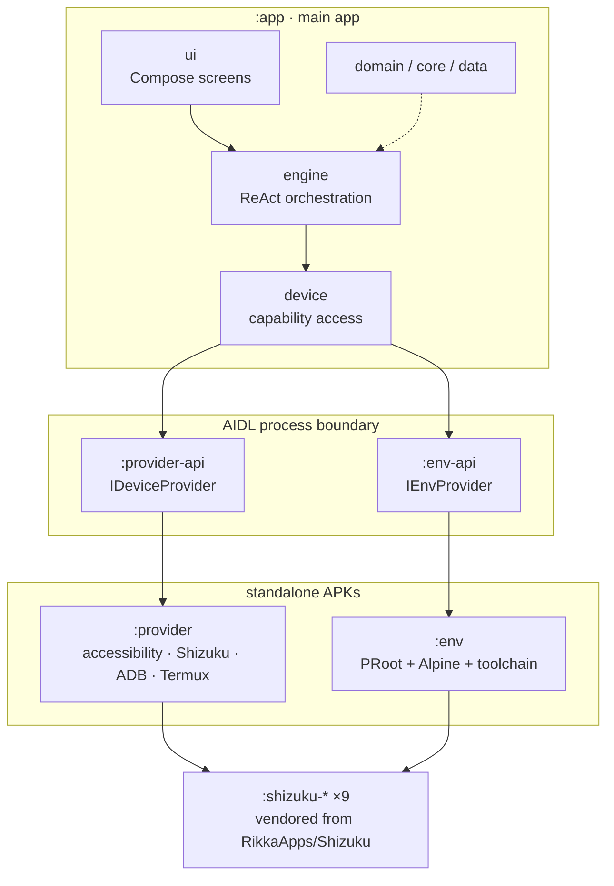

| Module | Responsibility |
|---|---|
| `:app` | Main app: UI, engine orchestration, AI client, storage (no system-permission code) |
| `:provider` | Standalone permission service APK: accessibility bridge, embedded Shizuku server, wireless ADB bootstrap, Termux |
| `:provider-api` | Cross-process contract: AIDL `IDeviceProvider` + Parcelable, shared by both sides |
| `:env` / `:env-api` | On-device coding environment (PRoot + Alpine + toolchain) and its `IEnvProvider` AIDL contract |
| `:shizuku-*` ×9 | Four client modules plus an embedded server/starter, so users never install the official Shizuku app |

### Main app layers

Dependencies point one way; `core` / `domain` sit at the bottom:

| Layer | Contents |
|---|---|
| `core` | Cross-cutting infrastructure: AiClient, ModelCatalog, VisionRouting, logging, redaction, notifications |
| `domain` | Pure models and rules: AgentIntent, AgentAction, CapabilityRegistry, EngineRules |
| `data` | DataStore settings, MemoryStore / TaskStore / DebugRecordsStore, log export |
| `device` | Device access: provider bridge, shell, vision, screen capture, device ops (FileOps / AlarmOps …) |
| `engine` | ReAct orchestration: `loop`, `runtime`, `planning`, `decision`, `execution`, `perception`, `prompt` |
| `feature` | Feature domains: browser, mcp, skill, adskip, document, assistant, notify, update |
| `ui` | Compose screens (each page = one entry point + single-responsibility files) |

`engine/AgentEngine.kt` keeps only the loop skeleton and state exposure (~3,200 lines); the work is split into `loop/` (observe · decide · execute), `runtime/` (lifecycle, gating, telemetry, finalization), and `execution/` (translation, channel ladder, verified execution).

### Code size

| Module | Source | Notes |
|---|---|---|
| `app/src/main` | **356** Kotlin files / 91,003 lines | all main-app logic |
| `app/src/test` + `testDebug` | 125 files / 1,287 `@Test` | JVM unit tests |
| `provider` | 30 source files | permission service |
| `env` | 4 source files | coding environment component |
| `third_party/shizuku` | 156 source files | vendored upstream |

`app/src/debug` ships a debug-only log forwarding path (`LogServerCore` / `LogTransferSession` / `UsbDebugWatcher`) that streams logcat and in-app logs to [tool/hpa_log_receiver.py](tool/hpa_log_receiver.py) over a local port. None of it exists in release builds.

## ⚙ Core mechanisms

### Three-shape routing

Every input is classified before it reaches an executor, and there is exactly one classifier: [TaskKindDetector](app/src/main/java/com/phoneagent/engine/TaskKindDetector.kt).

| Shape | Rule | Executor |
|---|---|---|
| **Coding** | coding-term hits ≥ chat-term and action-term hits | delegated to the on-device coding agent, no ReAct perception loop |
| **Chat** | only chat terms, and none of doc / open / browse / fetch / assistant | one direct model reply (`CHAT_TEMPERATURE = 0.3`), no control prompt |
| **Agent** | everything else | the ReAct main loop |

The same classifier decides how prompts are trimmed (`flagsOf`), so "trim for a web task" and "inject extra guidance for an ordinary task" share one rule set instead of drifting apart. When several requests arrive together ("write a script and send it to me on WeChat"), the highest-confidence shape wins and the timeline notes the rest can be ordered next.

### Intent and capability registry

All 65 intents are declared once, as `CapabilitySpec` entries in `CapabilityRegistry` inside [CapabilitySpec.kt](app/src/main/java/com/phoneagent/domain/model/CapabilitySpec.kt). Each carries a name, category, purpose, risk tier, and target action. The translator, action-mode gate, skill catalog, and prompt consistency checks are **derived** from that table, so adding a capability should touch only two places: one registry entry, plus one target row in the channel ladder if it really produces a device action. `CapabilityRegistryTest` asserts that `IntentType.ALL` equals the registry key set exactly.

[IntentTranslator](app/src/main/java/com/phoneagent/engine/execution/IntentTranslator.kt) lowers intents into 37 internal actions (`ActionType`), with three outcomes:

| Outcome | Meaning | Engine response |
|---|---|---|
| `Command` | a concrete action was produced | hand to the execution layer |
| `Failed` | page preconditions unmet / invalid arguments | the reason is fed back so the AI tries another route |
| `MissingParam` | a required field is absent (e.g. tap with no target) | the end side asks the AI to fill it in, then re-translates |

The nine `browse_*` intents, plus `see` and `web_search`, are not in the action table: the browse family is carried out by the built-in browser via DOM scripts, and the other two call the vision model or a search directly. None of them produce an `ActionType`.

### Action modes

[ActionMode](app/src/main/java/com/phoneagent/engine/execution/ActionMode.kt) is **orthogonal** to the channel mode (`CapabilityManager.Mode`): channel mode answers "can this execute" (does the device have the permission), action mode answers "may the AI ask for this" (how much authorization the user granted).

| Tier | Allowed |
|---|---|
| 🛡 CONSERVATIVE | the 35 low-risk intents (read-only / navigation / scrolling / local read-write / read-only browsing) |
| ⚖️ BALANCED (default) | low risk + 21 medium + 5 high, 61 in total |
| 🔓 FREE | everything, plus `terminal_op`, `shell` (AI-authored commands), `virtual_display`, and `a11y` (17 accessibility endpoints called directly, each confirmed once before first use) |

There is exactly one gate: in the main loop, after skill normalization and before browser dispatch. The position is deliberate — `browse_*` never passes through the translator, so this is the only spot that can cover it. Three consecutive denials end the task and suggest relaxing the tier.

### The ReAct loop

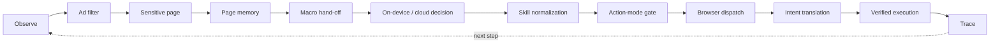

Key designs:

- **On-device first**: `LocalDecisionEngine` handles dialogs, loading, and ads; every 5 consecutive local decisions force one cloud re-check.
- **Decision errors don't consume steps**: on cloud flakiness the loop decrements `step` and retries, so a network hiccup can't burn the step budget; five consecutive errors end the task.
- **Early-completion interception**: the bar is 60% of planned steps with a plan, or 3 steps without one — unless the page already shows explicit completion evidence (reusing the idempotency check), in which case it passes.
- **No "when unsure, declare done"**: the system prompt requires `give_up` when stuck rather than a vague finish.
- **Mid-run disconnect detection**: if the accessibility service disappears mid-task (vendor security tools revoking it), the run pauses and asks for re-authorization instead of looping blind.

#### Timeline of one task

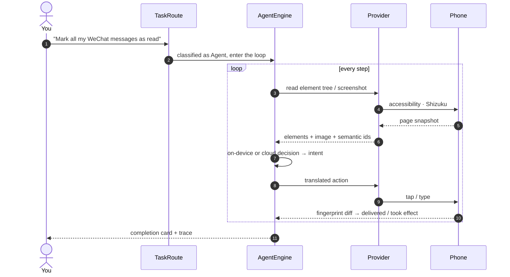

### Provider and execution channels

[ProviderManager](app/src/main/java/com/phoneagent/device/provider/ProviderManager.kt) is the main-app-side portal: install guidance and version comparison, `bindService` into `IDeviceProvider` (3-second timeout, automatic rebind on disconnect), and remote calls with timeout fallbacks. Four hard-won details:

- **Only a truly dead channel drops the proxy**: `DeadObjectException` / `RemoteException` invalidate it; `TransactionTooLargeException` is a business failure (oversized reply) and keeps the connection.
- **Invalidation must really unbind**: clearing a reference without unbinding leaves the system believing the connection is live, so the next `bindService` never calls back — the exact cause of "shows connected but every command disappears".
- **Large payloads are chunked**: screenshots and element trees travel as `beginPayload` / `readPayload` / `endPayload`, 128 KB per chunk, staying under Binder's ~1 MB transaction limit.
- **A channel self-check**: "installed? → enabled? → bound? → tree readable? → screenshot? → Termux in three steps", each step reporting real numbers.

Channel selection has a single decision point, [ShellRules.pickChannel](app/src/main/java/com/phoneagent/engine/execution/ShellRules.kt):

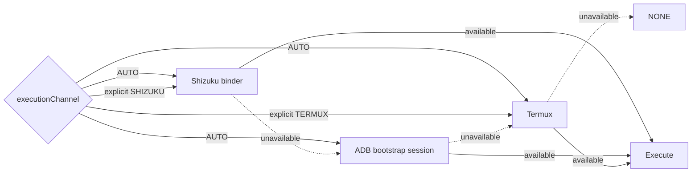

| Channel | Privilege | Can do |
|---|---|---|
| Embedded Shizuku | shell (adb) | system commands such as `am` / `pm` / `settings` / `input` |
| ADB bootstrap session | shell (adb) | same; a transitional state while the server starts, presented to users as Shizuku |
| Termux | **ordinary app privileges** | curl / python / jq / text processing — **cannot** run system commands |

Termux's `RUN_COMMAND` permission, result PendingIntent delivery, and the `allow-external-apps` check all happen inside the Provider; on the app side [TermuxBridge](app/src/main/java/com/phoneagent/device/shell/TermuxBridge.kt) only forwards AIDL and exposes cached state.

### ShellCommands — commands an AI can remember

In free mode the AI writes its own commands, and it doesn't have to memorize ADB syntax. Coordinates accept three forms: percent (`50%`), ratio (`0.5`, only when strictly below 1), or pixels (`500`).

<details>
<summary><b>Expand the full command table (26 entries, plus <code>raw</code> for pass-through)</b></summary>

| Command | Arguments | Notes |
|---|---|---|
| `tap` / `lp` / `dt` | `x y` | tap / long-press 1500 ms / double-tap |
| `sw` | `x1 y1 x2 y2` | swipe |
| `su` / `sd` / `sl` / `sr` | `x y` | directional swipe, 25% of the screen (at least 100 px) |
| `key` | `BACK/HOME/ENTER/RECENTS/MENU/VOLUME_UP/…/digits` | key press |
| `back` / `home` / `recents` | — | system keys |
| `text` | `"text"` | type text |
| `am` / `launch` / `stop` / `dump` | package or component | launch / force-stop / list activities (a bare package becomes a launch) |
| `info` / `window_size` / `battery` / `date` | — | device info |
| `clip` / `clipboard` | — | read the clipboard |
| `brightness` | `0~255` | screen brightness |
| `screenshot` | — | capture to `/sdcard` |
| `wifi_on` / `wifi_off` | — | toggle Wi-Fi |
| `raw` | full ADB command | pass-through escape hatch |

</details>

### Vision pipeline

[VisionRouting](app/src/main/java/com/phoneagent/core/ai/VisionRouting.kt) turns "which vision path" into a pure function that unit tests can cover:

| Source | Trigger | Output |
|---|---|---|
| On-device 3B (GGUF + JNI) | downloaded, loaded, and (hybrid routing off or the page is simple) | control type + purpose + normalized coordinates |
| Cloud vision model | hybrid routing judges the page complex, or the on-device model is unavailable | textual description of the screenshot |
| ML Kit Chinese OCR | neither of the above produced anything | text regions clustered into controls |

"Page complexity" is measured by **element-tree sparsity**: `elements.size ≤ 3` means a complex page (accessibility can see almost nothing, so strong semantics are needed) and goes to the cloud; anything denser goes to the on-device 3B. Supporting constraints: whether the main model can read images directly is a tri-state (`AUTO` follows a real model-catalog probe / `ON` / `OFF`); the native 3B layer carries a 120-second inference watchdog returning `__ERR_TIMEOUT__`, which Kotlin falls back from to OCR; the whole vision pipeline has a 25-second outer watchdog; and when page fingerprint + screenshot size + task id all match, the previous visual result is reused and all three paths are skipped.

### Semantic annotation

[PageAnnotator](app/src/main/java/com/phoneagent/engine/perception/PageAnnotator.kt) assigns stable semantic ids to 26 common control types after every observation, so the AI can simply emit `target={by:"id",value:"send_btn"}`:

```text
dlg_allow / dlg_dismiss / ad_skip / back_btn / close_btn / search_box / search_btn / refresh_btn
send_btn / confirm_btn / checkout_btn / delete_btn / switch_toggle / select_box / more_btn / add_btn
next_btn / login_btn / share_btn / collect_btn / copy_btn / download_btn / upload_btn
settings_btn / sort_btn / clear_input
```

Two implementation constraints: element features are precomputed once (the original implementation scanned the full element list 26 times, regenerating thousands of strings on long list pages), and `dlg_dismiss` is only assigned when the modal is confirmed real (a positive button exists and the page has ≤ 8 elements), so an ordinary page's "cancel" isn't mistaken for closing a dialog.

### Prompts

[PromptCatalog](app/src/main/java/com/phoneagent/engine/prompt/PromptCatalog.kt) is the single list of prompt bodies — 60 blocks, each with assembly conditions (`requires` / `excludes`). `PromptAssembler` orders them, joins them, and renders placeholders for the whole group in one pass.

- **Never trimmed**: the iron rules, the authorization scope, output prohibitions, and capability declarations (`safe = true`).
- **Trimmed by task**: non-web tasks drop "web browsing", non-open tasks drop "open links and files".
- **Guide blocks**: voice-assistant, coding, and chat guidance are injected only when clearly relevant; unknown tasks get neither.
- Joining with `body + sep` must reproduce the original newlines exactly — `PromptSnapshotTest` locks it with golden samples, so changing `sep` is changing the prompt.

### Memory

| Type | Storage | Purpose |
|---|---|---|
| User profile | `MemoryStore` | preferences and habits that apply across tasks |
| AI memory | `MemoryStore` (deduplicated) | long-term facts distilled by the model at task end |
| Experience rules | `EvolvedRule` | scoped rules; scope is inferred from foreground-app counts |
| Anomaly experience | `AnomalyMemoryEngine` | past handling of similar page anomalies, reused when matched |
| Task memory | `MemoryStore` (`task_memory` key) | goal / requirements / verified methods / state / steps, capacity 30 |
| Page memory | `MemoryStore` | per-page control spatial tree plus hotspots, drawn as a wireframe phone |

Page memory marks remembered controls with faint rings on screen (which don't block touch) and injects "where you can go from this page" into the decision prompt.

### Coding environment and coding agent

`:env` (targetSdk 28) hosts the PRoot + Alpine root filesystem and is driven from the app over `IEnvProvider`. [CodingEnvBootstrap](app/src/main/java/com/phoneagent/coding/env/CodingEnvBootstrap.kt) turns the whole chain into a repeatable flow:

```text
probe → install component → all-files access → component storage grant → Linux root → JDK 17 → Gradle
      → cmdline-tools → platform / build-tools → aapt2 compatibility layer → assembleDebug
```

Each call advances only to the **first step that needs a human** and opens the matching system screen, returning `needsUserAction`; the user completes it and re-runs, and finished steps never repeat. Two hard constraints are handled explicitly: the environment component runs as another uid and cannot read the app's `filesDir`, so private workspaces are mirrored to `/storage/emulated/0/happyac-build/<project>`; and aapt2 ships only for x86_64, so on arm64 devices it runs under `qemu-x86_64` with glibc translation.

Coding tasks run on an embedded Node host (`assets/agent-host`, shipped in the APK) and are **fully isolated** from the control pipeline: separate session ids, workspaces, and state directories (`<workspace>/.happyac/agent` — switching workspace switches the whole memory set).

- **Workspaces**: chosen by the `CodingWorkspaces` registry (default `filesDir/workspaces/default`, optionally shared storage). Sessions, memory, usage, and model tier all follow the workspace.
- **Host bridge**: `HostBridgeServer` exposes workspace files, the editor, and previews to the Node side, plus four environment bridge methods: `env_status` / `env_setup` / `env_build` / `env_cancel`.
- **CA alignment**: Node's bundled Mozilla CA store lacks some domestic gateway roots, so startup concatenates the system CAs into a PEM and passes it as `NODE_EXTRA_CA_CERTS` (appended, not replaced), keeping Node's trust set aligned with OkHttp's.
- **Bundled skills**: `assets/skills/<name>` is written to `filesDir/skills` on first use according to the `version` in `skill.json`; an unchanged version is skipped so user edits survive.
- **Shared-in files**: docx / xlsx / pptx / zip also get a plain-text excerpt (`<name>.text.txt` beside the original), otherwise `read_file` returns binary.

### Browser channel

The nine `browse_*` intents are carried out by the built-in WebView's DOM scripts and are **independent of device capability** (no accessibility, Shizuku, or Termux needed), so the AI can literally read the web page. Bodies come back as Markdown with links inlined as `[text](url)`. Fetched HTML is sniffed and converted **before** truncation — in the other order, a 4,000-character budget usually stops mid-`<head>`. Element clicks target by text first and fall back to CSS selectors. Re-injection budgets and shell output share `AgentBudgets.REINJECT_MAX_CHARS` (4,000).

### Skills and MCP

- **Built-in skills**: `SkillCatalog` registers every intent as a skill with parameter descriptions, and `legacyIntent` points back to the original intent name. `SkillCompat.normalize` ensures that "old intent name / skill id / Chinese skill name" all land on the same translation path.
- **Macro skills**: multi-step skills are dispatched end-side. Before dispatch the whole macro is pre-checked (steps exist and are enabled; intent steps pass the current action mode), and one denial prevents the entire macro. At runtime the first failing step stops the macro and hands control back to the AI.
- **MCP skills**: remote JSON-RPC calls with a 20-second timeout, output truncated to 1,200 characters, and circuit-breaking after 3 consecutive denials. Marketplace entries are shortcuts only (a public REST site is not an MCP server; you need your own gateway).
- **Automatic argument inference**: when a call is rejected for missing required parameters, the end side infers them from successful historical arguments, the previous step's result, the original request, and page text — saving a round-trip to the AI.

### Safety

| Mechanism | Implementation |
|---|---|
| Sensitive pages are read-only | `SensitivePageDetector` recognizes payment / password / verification-code keywords; five consecutive takeovers on a still-sensitive page end the task |
| Data redaction | 18-digit ID → 16–19-digit bank card → 11-digit phone number, masked longest-first; anything under 11 digits takes a fast path and returns immediately |
| Irreversible-action confirmation | actions flagged `needsUserConfirmation` always ask first; a 120-second timeout counts as cancel |
| Free-mode command confirmation | an AI-authored command is confirmed once before its first run this task; refusal is fed back as "don't retry this" |
| Idempotency guard | when the page already shows completion evidence, repeated side effects (submit / send / order / pay / delete) are skipped |
| Secret storage | `SecretCodec` encrypts before anything reaches DataStore |

## 🖼 Screens

> Real device captures, light and dark. All of them live in [docs/ui-shots/](docs/ui-shots/).

<table>
  <tr>
    <td align="center">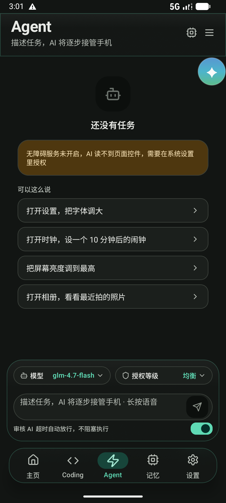<br><sub>Home · Agent</sub></td>
    <td align="center">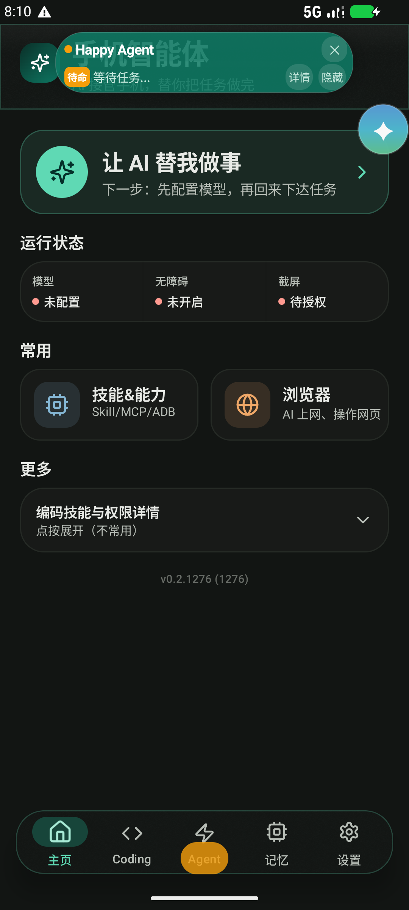<br><sub>Task card, running</sub></td>
    <td align="center">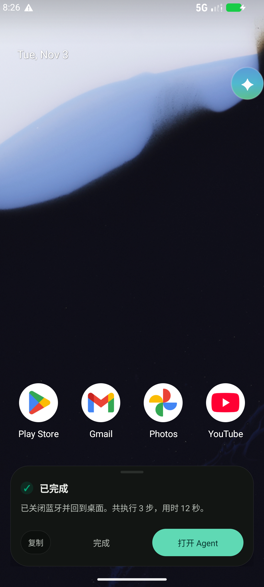<br><sub>Completion card</sub></td>
    <td align="center">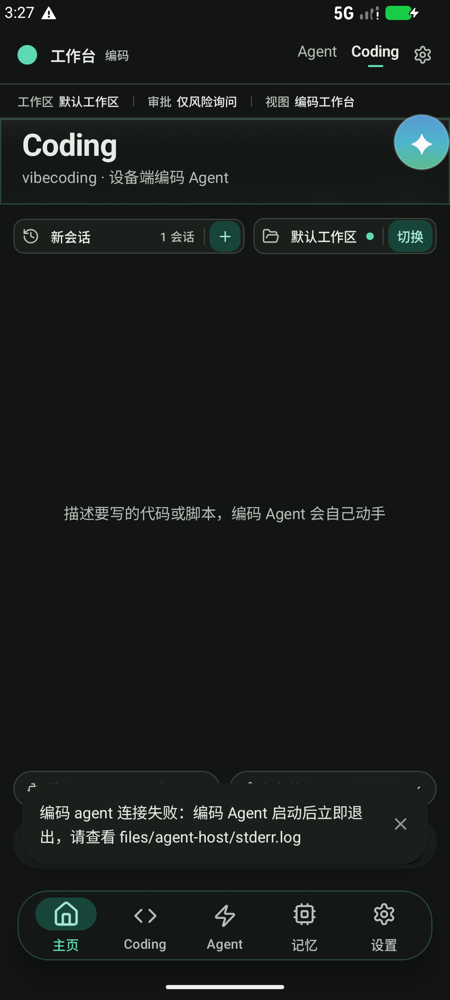<br><sub>Coding · dark</sub></td>
    <td align="center">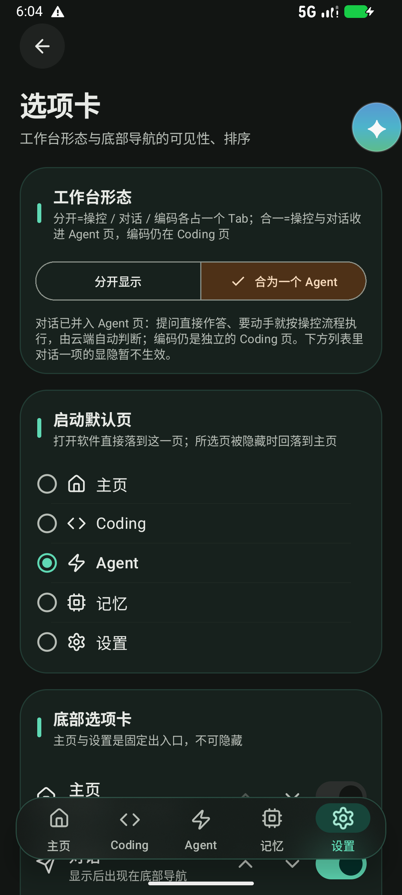<br><sub>Settings · dark</sub></td>
  </tr>
  <tr>
    <td align="center">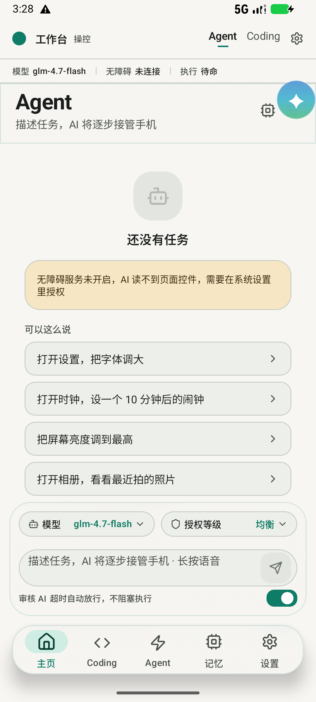<br><sub>Agent workbench · light</sub></td>
    <td align="center">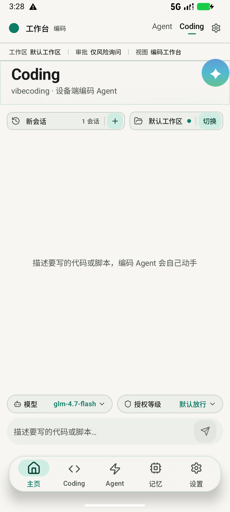<br><sub>Coding · light</sub></td>
    <td align="center">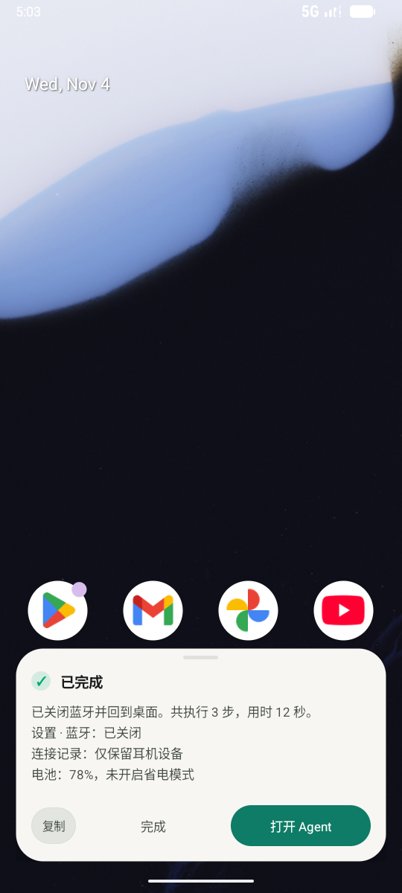<br><sub>Overlay completion card</sub></td>
    <td align="center">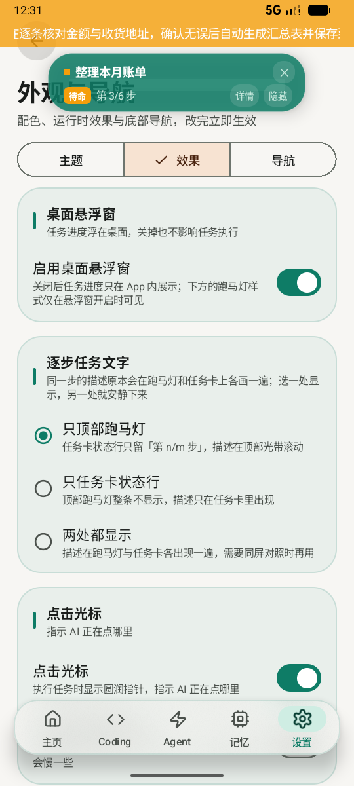<br><sub>Appearance &amp; effects</sub></td>
    <td align="center">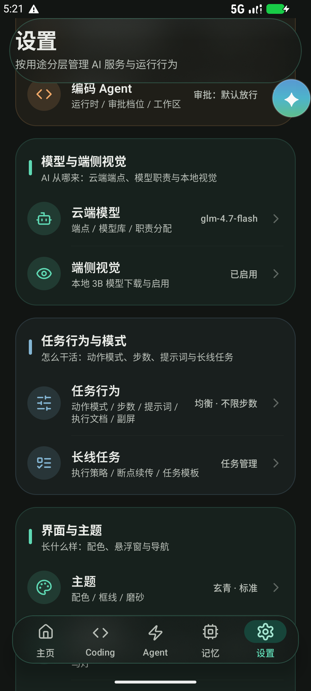<br><sub>Four palettes</sub></td>
  </tr>
</table>

Prefer not to install anything? Open [promo/app.html](promo/app.html) — a **zero-dependency single file** interactive replica that opens straight in a browser. Every icon and illustration is inline SVG; no network, no CDN.

The app sits in a 412×892 logical screen (434×914 body + rounded corners + side keys + home indicator), and window resizes only scale the whole device proportionally. It covers home, chat, coding, control (plan approval / running / done), the memory graph with page-memory drill-down, the full settings tree, skills and MCP, the built-in browser, document reading, the test workbench, and debug views — plus onboarding, the assist overlay, the irreversible-action confirmation card, and the voice input overlay. It follows system light/dark and switches among four palettes (Xuanqing / Ocher / Dai Blue / Crimson) live under Settings → Theme. Design tokens come from `Color.kt` / `Theme.kt` / `Type.kt` / `Motion.kt`, matching the Compose sources one to one.

`promo/index.html` and `promo/ui-film.html` in the same folder are promo storyboard pages (the demo video itself is not committed).

## 🔧 Configuration

Settings are three levels deep: settings home → category → detail page. Categories are AI access (cloud models / on-device vision), coding agent, runtime behavior (prompts and long-running tasks), device access (permissions and channels), appearance (theme / interface effects / bottom tabs), and system (data and storage / updates / about and help).

### Models

| Role | Used for | Default | Required |
|---|---|---|---|
| Main model | per-step decisions, intent understanding, direct chat replies | `glm-4.7-flash` | ✅ |
| Vision model | screenshot description, coordinate grounding | `glm-4.6v-flash` | optional |
| Reasoning model | planning, ambiguity detection, replanning | `glm-4.7-flash` | optional |

Endpoints (Base URL + key) and models are managed separately, and capability badges come from real request probes; the "role assignment" screen binds models to the main / vision / reasoning slots. Chain aggregation is off by default and lets the reasoning model join complex planning when enabled. Any OpenAI-compatible endpoint works; the default points at Zhipu's open platform.

### Other key switches

| Setting | Default | Notes |
|---|---|---|
| `executionChannel` | AUTO | AUTO / SHIZUKU / TERMUX; a legacy `ADB` value normalizes to AUTO on read |
| `actionMode` | BALANCED | CONSERVATIVE / BALANCED / FREE |
| `attachScreenshot` | on | attach a screenshot to each model call |
| `enableExternalVision` | on | enable the on-device 3B model |
| `smartVisionRoute` | on | hybrid routing: simple tasks on-device, complex ones in the cloud |
| `pageMemoryEnabled` | on | page memory plus on-screen hotspot marks |
| `floatingWindowEnabled` | on | overlay window (turning it off does not affect task execution) |
| `enableReview` | on | an independent reviewer AI checks that each action is grounded in page evidence |
| `virtualDisplayEnabled` | off | secondary-display mode: tasks run on a virtual display without stealing the foreground (needs Shizuku) |
| `promptLanguage` | CN | prompt language (Chinese / English) |

## 🚪 Entry points

| Entry | Implementation |
|---|---|
| Main UI | configurable tabs: Home / Chat / Coding / Agent / Memory / Settings. In the default "unified" shape chat folds into the Agent page, which picks direct reply or control based on the cloud's intent classification; switching to "split" gives chat its own tab |
| Floating window | `FloatingWindowService` — plan approval, ambiguity clarification, manual guidance, stop |
| System notifications | `TaskProgressNotifier` for progress plus `ActiveNotifier` for proactive feedback (stalls, loops, stale templates) |
| Home-screen widget | `AgentStatusWidgetProvider` — task name + status + step count |
| Quick Settings tile | `AgentTileService` — one tap to summon or dismiss the overlay and the task |
| App Shortcuts | static shortcuts (new task / resume last / open memory) plus App Actions `GET_THING` voice access |
| Share targets | `ACTION_SEND` / `ACTION_SEND_MULTIPLE` / `ACTION_PROCESS_TEXT` / `ACTION_VIEW` |
| System assistant | `HpaVoiceInteractionService` — long-press power or an edge gesture, landing on the Agent page |
| Voice input | system `SpeechRecognizer` or a configured OpenAI-compatible transcription endpoint |
| External broadcasts | `TaskControlReceiver` — lets Tasker / MacroDroid dispatch tasks (off by default, token-checked) |

## ❓ FAQ

<details>
<summary><b>Do I need root, or a separate Shizuku install?</b></summary>

Neither. The Provider embeds the Shizuku server and starts it via `app_process` under the shell uid, so the official app is unnecessary. Without Shizuku it falls back to a wireless ADB bootstrap session, and Termux remains as a channel that needs only ordinary app privileges.

</details>

<details>
<summary><b>Will it tap the wrong thing, or pay for something?</b></summary>

Three gates: action mode restricts what the AI may ask for (balanced by default; payment and deletion are free-mode only), actions flagged `needsUserConfirmation` always ask first, and sensitive pages (payment / password / verification code) are read-only — five consecutive takeovers on a still-sensitive page end the task. Repeated side effects are also skipped when the page already shows completion evidence.

</details>

<details>
<summary><b>Which models does it support, and must it be online?</b></summary>

Any OpenAI-compatible endpoint. Planning and decisions need a cloud model, but vision can run entirely on-device with the 3B model plus ML Kit OCR; the on-device model only affects whether the page is understood, it never replaces the decision model.

</details>

<details>
<summary><b>Why two APKs?</b></summary>

Permission containment. Accessibility, Shizuku, and Termux are all privileged, so they live in a separate process; the main app can be audited line by line and still contain no permission code. The coding environment (`:env`) is separate for a different reason: it must target SDK 28 to `execve` binaries from its private directory.

</details>

<details>
<summary><b>Why trust the numbers in this README?</b></summary>

Because scripts count them out of the code (files, `@Test` cases, intents, detekt baseline distribution). When code changes, the baseline guard and `CapabilityRegistryTest` go red before the docs can drift.

</details>

## 📚 Documentation

`docs/` in this repo is **authoritative**; the [Wiki](https://github.com/xkx121029/Phtomt/wiki) is the public portal distilled from it. Start at [docs/README.md](docs/README.md).

| To learn about | Read |
|---|---|
| Top-level layout, module dependencies, version flow | [docs/project-structure.md](docs/project-structure.md) |
| Responsibilities and dependencies of all 14 modules | [docs/build-modules.md](docs/build-modules.md) |
| CI triggers, artifacts, re-attaching, troubleshooting | [docs/release-pipeline.md](docs/release-pipeline.md) |
| Assistant role boundaries | [docs/assistant-role-contract.md](docs/assistant-role-contract.md) |
| Where degradation notices go and how they read | [docs/task-notice-contract.md](docs/task-notice-contract.md) |
| Virtual secondary display: design and limits | [docs/virtual-display-design.md](docs/virtual-display-design.md) |
| Brand VI / UI refresh / theme hand-off | [docs/brand-vi.md](docs/brand-vi.md) · [docs/ui-refresh-plan.md](docs/ui-refresh-plan.md) · [docs/ui-theme-handoff.md](docs/ui-theme-handoff.md) |

<details>
<summary><b>Deep-dive design and retrospective notes (<code>杂项/</code>, Chinese)</b></summary>

| Document | Contents |
|---|---|
| [项目完整流程说明.md](杂项/项目完整流程说明.md) | global architecture: perception / decision / execution / vision / persistence / presentation |
| [HPA动作执行逻辑优化文档.md](杂项/HPA动作执行逻辑优化文档.md) | the intent DSL (`intent` / `target{by,value}`) and execution-layer translation rules |
| [IntentTranslator转译层原理.md](杂项/IntentTranslator转译层原理.md) | intent → action matrix translation and channel selection |
| [IntentTranslator_Bug分析.md](杂项/IntentTranslator_Bug分析.md) | postmortems and root causes from the translation layer |
| [HPA中长线任务优化及agent逻辑优化文档.md](杂项/HPA中长线任务优化及agent逻辑优化文档.md) | long-task progress memory, checkpoints, loop prevention, templates |
| [HPA项目AI提示词全集.md](杂项/HPA项目AI提示词全集.md) | every prompt, Chinese and English |
| [HPA项目ai温度文档.md](杂项/HPA项目ai温度文档.md) | rationale for each prompt's temperature |
| [HPA系统级集成可发展项目清单.md](杂项/HPA系统级集成可发展项目清单.md) | 14 system-integration candidates, research and status |
| [HPS ai标准化测试.md](杂项/HPS%20ai标准化测试.md) | prompt standardization test plan and results |

</details>

## 🗓 Versions and updates

The full changelog lives in [CHANGELOG.md](CHANGELOG.md) (Keep a Changelog + semantic versioning, in Chinese). Auto-update queries `GET {baseUrl}/api/update/check?channel=<stable|beta|dev|nightly>` against the default site `https://hpa.linshuxu.us.kg`; installation prefers a silent install through the embedded Shizuku and falls back to the system installer. The release pipeline is documented in [docs/release-pipeline.md](docs/release-pipeline.md).

## 🤝 Contributing

1. Fork the repo and branch off `main` (`git checkout -b feature/xxx`).
2. Write Conventional Commits.
3. Push and open a pull request — CI runs the full gate described above.

Conventions:

- Follow the [Kotlin style guide](https://developer.android.com/kotlin/style-guide), 4-space indent.
- Dependencies point one way: `core` / `domain` at the bottom may never depend on `engine` / `device` / `ui`; inside `engine`, keep the main class to the loop skeleton and push work into subpackages.
- **Adding a capability touches two places**: one `CapabilitySpec` in `CapabilityRegistry`, and one target row in the channel ladder if it produces a device action. Names, categories, risk tiers, the skill catalog, and prompt consistency are all derived; `CapabilityRegistryTest` and `ActionMode.missingTiers()` catch omissions.
- Register new prompt blocks in `PromptCatalog` only; bodies go in `PromptBodies`.
- UI changes follow Material 3 Expressive, with colors and shapes per [docs/brand-vi.md](docs/brand-vi.md).
- No dead code: a class named in this README or a comment that no longer exists in code is a bug.

## 📄 License

Released under the [MIT License](LICENSE).

## 🙏 Acknowledgements

- The Material Design team, the Jetpack Compose community, and Google ML Kit
- [Shizuku](https://github.com/RikkaApps/Shizuku) — the foundation of the permission channel (vendored into `third_party/shizuku`)
- [Coda](https://github.com/happy-everyday-everyweek/coda) — an Android agent toolkit whose project organization and runtime design informed ours (AGPL-3.0)
- [MobileGym](https://github.com/Purewhiter/mobilegym) — a verifiable, highly parallel mobile GUI-agent research platform that informed our task design and verification (Apache-2.0)
- [Aether（扶摇）](https://github.com/Zhou-Shilin/Aether) — in-progress state display (de-emphasized process, result as a card, light sweeping across text) drew on its layering approach (GPL-3.0)
- And every open-source contributor

---

<div align="center">

<sub>Hand off the repetition. Take back the attention.</sub>

<br><br>

<a href="https://github.com/xkx121029/Phtomt/stargazers"></a>
<a href="https://github.com/xkx121029/Phtomt/issues/new/choose"></a>
<a href="https://xkx121029.github.io/Phtomt/"></a>

<br><br>

<sub>Ink · Paper · Firefly · Grid — the mark is <i>Liàng Gé</i></sub><br>
<a href="https://github.com/xkx121029/Phtomt#readme">Back to top ↑</a>

</div>
