<div align="center">


<p><b>把一句话交给手机，它自己把事做完。</b></p>

<p>
  <a href="https://github.com/xkx121029/Phtomt/actions/workflows/android-ci.yml"></a>
  <a href="https://github.com/xkx121029/Phtomt/releases"></a>
  <a href="LICENSE"></a>
  <a href="https://github.com/xkx121029/Phtomt/wiki"></a>
  <a href="https://xkx121029.github.io/Phtomt/"></a>
</p>

<p>
  
  
  
  
  
</p>

<p>
  <a href="https://xkx121029.github.io/Phtomt/">在线官网</a> ·
  <a href="promo/app.html">离线 UI 复刻</a> ·
  <a href="https://github.com/xkx121029/Phtomt/wiki">Wiki</a> ·
  <a href="CHANGELOG.md">更新日志</a>
</p>

<p>
  <b>简体中文</b> · <a href="README.en.md">English</a>
</p>

</div>

---

Happy Agent 是一个运行在 Android 上的 AI 智能体。你说"帮我把微信消息全部标为已读"或"订一份外卖"，它自己观察当前页面、规划步骤、决定点哪里、输入什么，并在你授权的范围内把事做完。

它和大多数"AI 遥控器"式实现有两条硬边界：

> **系统权限代码不写在主应用里。** 无障碍、内置 Shizuku server、Termux 三条能力通道全部封装在独立的 Provider APK，主应用经 AIDL 远程驱动，权限收敛到一个可单独审计的进程。

> **AI 不写命令、不算坐标、不选通道。** 它只输出 65 个语义意图之一，坐标换算、命令拼装、通道选择全在端侧转译层完成，模型换谁都能跑。

<details open>
<summary><b>📑 目录</b></summary>

| 入门 | 深入 |
|---|---|
| [📌 项目速览](#-项目速览) | [⚙ 核心机制](#-核心机制) |
| [✨ 亮点](#-亮点) | [三形态路由](#三形态路由) · [意图与能力注册表](#意图与能力注册表) · [动作模式](#动作模式) |
| [🚀 快速开始](#-快速开始) | [ReAct 主循环](#react-主循环) · [Provider 与执行通道](#provider-与执行通道) |
| [环境要求](#环境要求) · [构建](#构建) | [视觉链路](#视觉链路) · [提示词](#提示词) · [记忆体系](#记忆体系) |
| [质量闸门](#质量闸门) · [可选构建模块](#可选构建模块) | [编码环境与编码 Agent](#编码环境与编码-agent) · [安全防护](#安全防护) |
| [🧱 技术栈](#-技术栈) | [🖼 界面](#-界面) · [🔧 配置](#-配置) · [🚪 入口](#-入口) |
| [🗺 架构](#-架构) | [📚 文档](#-文档) · [🤝 贡献](#-贡献) · [📄 许可](#-许可) |

</details>

## 📌 项目速览

<p align="center">
  
  
</p>

| | |
|---|---|
| **形态** | Android 原生应用（Kotlin + Compose），14 个 Gradle 模块 |
| **能力模型** | 65 个意图（4 档风险）→ 24 种实际使用的动作类型，3 条执行通道 |
| **模型要求** | 任意 OpenAI 兼容端点；默认 `glm-4.7-flash`，无强制云依赖 |
| **系统要求** | Android 8.0+（API 26），无需 Root、无需单独安装 Shizuku |
| **文档** | `docs/` 为权威源，[Wiki](https://github.com/xkx121029/Phtomt/wiki) 为对外门户 |

## ✨ 亮点

| 能力 | 一句话 |
|---|---|
| 🧭 **三形态路由** | 每次输入先判定「手机操控 / 编码委托 / 纯对话」，不为一句"你好"启动整条感知循环 |
| 🎯 **AI 只说意图** | 65 个意图 → 24 种实际使用的动作类型，坐标、命令、通道都由端侧决定 |
| 🔐 **三档授权** | 动作模式管"允不允许提这类请求"，通道模式管"设备有没有权限"，两者正交 |
| ⚡ **端侧优先决策** | 弹窗、加载、广告等高频页面本地处理，不烧云端额度 |
| 👁 **多源视觉** | 端侧 3B（GGUF + JNI）、云端视觉模型、ML Kit 中文 OCR 三路按页面复杂度自动分流 |
| ✅ **带验证执行** | 页面指纹前后比对，结论分「已确认生效」「已交付但未确认」「已交付但未见效」三态，未确认既不折成成功也不折成失败 |
| 💻 **设备内编码** | PRoot + Alpine + JDK + Gradle + SDK 一键装好，手机上直接 `assembleDebug` |
| 🧠 **长任务不跑偏** | 任务记忆、检查点、熔断计数、模板复用，外加中途掉线检测与敏感页只读 |

## 🚀 快速开始

### 环境要求

- Android Studio Hedgehog 或更新版本
- JDK 17（`compileOptions` 与 `kotlin.jvmTarget` 均为 17）
- Android SDK 36
- 一台 Android 8.0+ 手机（minSdk 26）
- **不需要**单独安装 Shizuku：server 随 Provider APK 一起安装

### 构建

```bash
git clone https://github.com/xkx121029/Phtomt.git
cd Phtomt

./gradlew :app:syncProviderAssets :app:syncEnvAssets   # 首次克隆必做，见下文
./gradlew :app:assembleDebug
# 产物：app/build/outputs/apk/debug/app-debug.apk
```

版本号只有 [version.properties](version.properties) 一个真值来源，`:app` 与 `:provider` 读同一个值：`versionCode = buildNumber`、`versionName = "0.2.$buildNumber"`。优先级是 `-PbuildNumber=NN`（CI 用 `github.run_number` 注入）> 文件记录值 > git 提交数；只有真正产出 APK 的任务（`assemble` / `bundle` / `build`）才自增并回写，跑 detekt / 单测不吃版本号。

### 首次克隆后必须同步子组件

Provider 与编码环境是两个**独立 APK**，`*.apk` 被全局忽略、不入库，克隆后缺它们就等于没有执行通道：

| 场景 | 必须执行 | 不同步的后果 |
|---|---|---|
| 首次克隆 | 两个都执行 | `assets/` 下只有 `version.txt`，装到手机后所有通道不可用 |
| 改了 `provider/` · `provider-api/` | `:app:syncProviderAssets` | 构建**直接失败**：`mergeAssets` 会比对源码指纹（[config/provider-assets/](config/provider-assets/) 下的 `.sha256`） |
| 改了 `env/` · `env-api/` | `:app:syncEnvAssets` | 不会失败，但包里是旧组件，运行时能力落后 |

`provider-api` 与 `env-api` 参与主应用编译，契约不一致会直接编译报错。

### 安装与配置

```text
1. 安装 APK，首次打开按引导安装「服务组件 Provider」（内含无障碍服务与 Shizuku server）
2. 授予权限：无障碍服务（必需）
            悬浮窗 / 通知使用权 / 屏幕录制 / 电池优化白名单（可选）
3. 设置 → AI 接入 → 云端模型：填端点与 Key，点「测试连接」
4. 设置 → 设备接入 → 权限与执行通道：跑一次「执行通道自检」
```

> [!TIP]
> 自检会把「装没装 → 开没开 → 绑没绑 → 元素树能不能读 → 截图能不能取 → Termux 三步」拆成可观察的步骤，每步都给实际数值（版本号 / 字节数 / 元素个数）。全部通过再下任务，比出事后再回头查快得多。

模型配置不完整时任务**不会启动**，直接给「去配置」入口，而不是跑到链路异常才报错。

### 质量闸门

```bash
./gradlew :app:detekt                       # 静态检查（规则见 config/detekt/detekt.yml）
./gradlew :app:checkDetektBaseline          # 基线只减不增，已挂到 check
./gradlew :app:checkDetektBaselineBreakdown # 基线分类合计必须等于总条目数
./gradlew :app:testDebugUnitTest
./gradlew :app:checkPureLogicCoverage       # 纯逻辑包覆盖率防回落
./gradlew :app:lintDebug
```

三点值得说明：

- **基线不只看总数。** 清 100 条超长行和修 1 个巨型类，在总数上看起来一样，所以额外维护 [baseline-breakdown.txt](config/detekt/baseline-breakdown.txt) 记录规则分布。当前 1543 条里 `MaxLineLength`(482) + `MagicNumber`(433) 就占了 59%，真正反映结构的 `LongMethod` / `CyclomaticComplexMethod` / `LargeClass` 合计约 12%。
- **覆盖率阈值只对纯逻辑包生效。** 主体逻辑依赖无障碍、Shizuku、悬浮窗，只能在真机跑，全局阈值只会逼人写无意义测试。阈值取"当前实测值"用于防回落而非追求目标：`domain/rules` 85%、`core/text` 87%、`engine/execution` 45%、`device/ops` 17%（后者多为 shell 命令拼装，JVM 测不到）。
- **`detekt` 任务在 CI 里仍是 `continue-on-error`。** 基线之外还有一批新增未清（数量随提交浮动），清理完即可恢复阻断；基线守卫本身是确定性阻断的。

CI（[android-ci.yml](.github/workflows/android-ci.yml)）在 PR / push 到 main 时按 detekt → 基线守卫 → 基线分类校验 → 单测 → 覆盖率 → 覆盖率闸门 → lint → `assembleDebug` 的顺序跑完整条门禁。

### 可选构建模块

默认 Android 构建之外，另有四类可选模块，由 [config/build-modules.properties](config/build-modules.properties) 的开关控制。它们的任务不挂到 `build` / `check` / `assemble` 上，启停不改变默认构建的任务图与耗时。

| 模块 | 开关 | 默认 | 主要任务 |
|---|---|---|---|
| Android 平台构建 | `hpa.modules.android.enabled` | 启用 | `androidCheck`、`androidPackage` |
| Vue 开发服务器 | `hpa.modules.vue.enabled` | 关闭 | `vueCheck`、`vueInstall`、`vueDev`、`vueBuild` |
| Git 工具链 | `hpa.modules.git.enabled` | 关闭 | `gitCheck`、`gitStatus`、`gitInfo` |
| GitHub 关联与同步 | `hpa.modules.github.enabled` | 关闭 | `githubCheck`、`githubLink`、`githubSync` |

`./gradlew buildModules` 查看开关与前置条件，`./gradlew buildModulesCheck` 只校验已启用的模块；也可用 `-Phpa.modules.<模块>.enabled=true` 临时覆盖。完整矩阵见 [docs/build-modules.md](docs/build-modules.md)。

## 🧱 技术栈

| 类别 | 技术 | 版本 |
|------|------|------|
| 语言 | Kotlin | 2.4.20 |
| 构建 | AGP / Gradle Wrapper | 8.13.2 / 8.14.4 |
| UI | Jetpack Compose（BOM） | 2026.06.01 |
| 设计 | Material 3 Expressive | 1.4.0 |
| 图标 / 毛玻璃 | Lucide Compose / Haze | 1.1.0 / 1.4.0 |
| 架构 | MVVM + 状态流 | StateFlow / Coroutines |
| 依赖注入 | Koin | 4.0.0 |
| 网络 | OkHttp | 4.12.0 |
| 序列化 | kotlinx-serialization | 1.7.3 |
| 存储 | DataStore Preferences | 1.1.1 |
| 端侧视觉 | Qwen2.5-VL-3B（GGUF + JNI `visionbridge`） | 双通路 |
| 本地 OCR | ML Kit 中文文字识别 | 16.0.1 |
| 静态检查 | detekt（基线只减不增） | 1.23.8 |
| Java / SDK | JDK 17 · minSdk 26 · compileSdk 36 · targetSdk 36 | — |

> [!NOTE]
> `:env` 的 targetSdk 固定 **28**：Android 10+ 的 W^X 只允许 targetSdk < 29 的应用 `execve` 私有目录下的程序，这是它必须独立成 APK 的唯一原因。

## 🗺 架构

### 14 个模块，按"谁能碰系统权限"切开

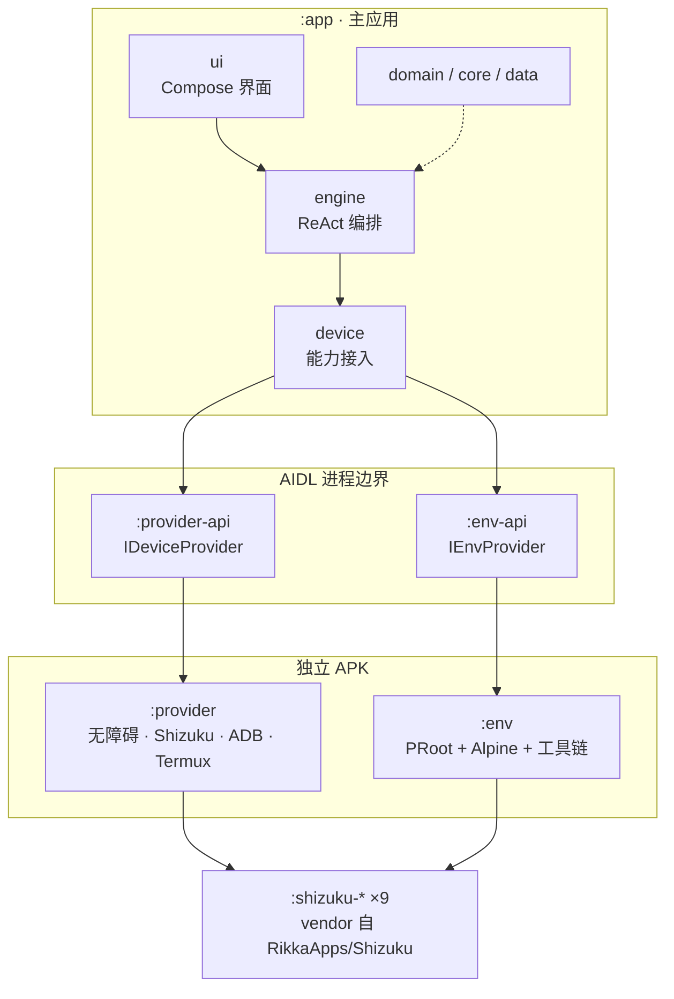

| 模块 | 职责 |
|---|---|
| `:app` | 主应用：UI、引擎编排、AI 客户端、数据存储（不碰系统权限代码） |
| `:provider` | 独立权限服务 APK：无障碍桥 + 内嵌 Shizuku server + 无线 ADB 引导 + Termux |
| `:provider-api` | 跨进程契约：AIDL `IDeviceProvider` + Parcelable，两端共用 |
| `:env` / `:env-api` | 设备内编码环境（PRoot + Alpine + 工具链）及其 AIDL `IEnvProvider` |
| `:shizuku-*` ×9 | 客户端四件套 + server/starter 内嵌，用户无需安装 Shizuku 官方 App |

### 主应用分层

依赖方向单向，`core` / `domain` 在最底层：

| 层 | 内容 |
|---|---|
| `core` | 跨层基础设施：AiClient / ModelCatalog / VisionRouting / 日志 / 脱敏 / 通知 |
| `domain` | 纯模型与规则：AgentIntent / AgentAction / CapabilityRegistry / EngineRules |
| `data` | DataStore 配置、MemoryStore / TaskStore / DebugRecordsStore、日志导出 |
| `device` | 设备接入：Provider 转发、shell、视觉、屏幕捕获、设备操作（FileOps / AlarmOps …） |
| `engine` | ReAct 编排：`loop` / `runtime` / `planning` / `decision` / `execution` / `perception` / `prompt` |
| `feature` | 功能域：browser / mcp / skill / adskip / document / assistant / notify / update |
| `ui` | Compose 界面（页面 = 入口 + 单一职责拆分文件） |

`engine/AgentEngine.kt` 只留主循环骨架与状态暴露（约 3200 行），具体职责按 `loop/`（观察·决策·执行三阶段）、`runtime/`（生命周期、门控、遥测、收尾）、`execution/`（转译、通道阶梯、带验证执行）等子包拆开。

### 代码规模

| 范围 | 源文件 | 行数 |
|---|---|---|
| `app/src/main` 主代码 | **370** | **93,959** |
| 单元测试（`app/src/test`） | **148** | **21,695**，含 1,461 个 `@Test` |
| 跨模块主代码（`app` + `provider` + `provider-api`） | **404** | **99,221** |
| 全仓 `.kt`（含 `env` / `third_party`） | **638** | **130,633** |

> 上表由 `tool/count-code.sh` 生成：口径是 `git ls-files` 列出的 `.kt` 文件、逐文件累计行数，不含 `cpp`。数字随代码增长，以生成时的提交为准；改了代码重跑脚本即可复现。

`app/src/debug` 另有一套仅 debug 变体的日志转发通道（`LogServerCore` / `LogTransferSession` / `UsbDebugWatcher`），把 logcat 与应用内日志经本机端口推给 [tool/hpa_log_receiver.py](tool/hpa_log_receiver.py)，release 包里不存在这段代码。

## ⚙ 核心机制

### 三形态路由

每次输入进执行体前先判定形态，唯一判定点是 [TaskKindDetector](app/src/main/java/com/phoneagent/engine/TaskKindDetector.kt)：

<p align="center">
  
  
</p>


| 形态 | 判据 | 执行体 |
|---|---|---|
| **Coding** | 编码词命中数 ≥ 对话词与操作词 | 委托设备端编码 agent，不进 ReAct 感知循环 |
| **Chat** | 只命中对话词，且 doc / open / browse / fetch / assistant 全不命中 | 主模型直答一次（`CHAT_TEMPERATURE = 0.3`），不注入操控提示词 |
| **Agent** | 其余情况 | ReAct 主循环 |

同一个判定器还决定提示词怎么裁块（`flagsOf`），所以「按网页任务裁提示词」和「按普通任务注入附加指导」用的是同一份口径，不会各说一套。多需求并存（"写个脚本顺便发我微信"）取命中数最高者，并在时间线提示其余需求可再下一单。

### 意图与能力注册表

65 个意图由 [CapabilitySpec](app/src/main/java/com/phoneagent/domain/model/CapabilitySpec.kt) 里的 `CapabilityRegistry` 统一声明，每条带名称、分类、用途、风险档和目标动作。转译层、动作模式门控、技能目录、提示词一致性检查全部从这张表**派生**，所以新增一个能力只该动两处：注册表加一条；如果它真的产生设备动作，再在通道阶梯表加一行目标。`CapabilityRegistryTest` 会强制 `IntentType.ALL` 与注册表键集完全相等。

[IntentTranslator](app/src/main/java/com/phoneagent/engine/execution/IntentTranslator.kt) 把意图落到内部动作（`ActionType` 共 38 个常量，能力注册表实际用到其中 24 种），三种结果：

| 结果 | 含义 | 引擎处置 |
|---|---|---|
| `Command` | 得到一条可执行动作 | 走执行层 |
| `Failed` | 页面条件不满足 / 参数非法 | 原因回注 AI 换路子 |
| `MissingParam` | 缺必填字段（如 tap 没 target） | 端侧先向 AI 追问补全，再重转译 |

9 个 `browse_*` 意图和 `see`、`web_search` 不在动作表里：前者由内置浏览器用 DOM 脚本直接落地，后两者由引擎就地调视觉模型或检索，都不产生 `ActionType`。

### 动作模式

[ActionMode](app/src/main/java/com/phoneagent/engine/execution/ActionMode.kt) 与通道模式（`CapabilityManager.Mode`）**正交**：通道模式回答"能不能执行"（设备有没有权限），动作模式回答"允不允许 AI 提出这类请求"（用户给了多大授权）。

<p align="center">
  
  
</p>


| 档位 | 放行范围 |
|---|---|
| 🛡 保守 CONSERVATIVE | 35 项可执行动作（只读 / 导航 / 滚动 / 本地读写 / 只读浏览） |
| ⚖️ 均衡 BALANCED（默认） | 61 项可执行动作（低风险 35 + 中风险 21 + 高风险 5） |
| 🔓 自由 FREE | 65 项全部可执行，另加 `terminal_op` / `shell`（AI 自写命令）/ `virtual_display` / `a11y` 这 4 项自由档专属（18 个无障碍端点直调，坐标类端点按 0~1 比例，首次执行前需确认） |

门控点只有一处：主循环里技能归一化之后、浏览器分流之前。位置是刻意的——`browse_*` 不走转译层，只有卡在这里才能一并覆盖。连续 3 次被拒即收尾，并提示放宽档位。

### ReAct 主循环

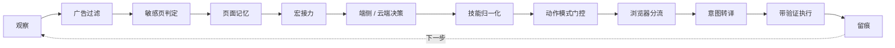

几个关键设计：

- **端侧优先**：`LocalDecisionEngine` 先处理弹窗、加载、广告这类高频页面；连续 5 次端侧决策强制走一次云端复核。
- **决策异常不计步**：云端抖动时 `step--` 后重试，避免网络问题烧光步数预算；连续 5 次异常才收尾。
- **提前完成拦截**：有计划时门槛是规划步数的 60%，无计划时是 3 步；但页面已出现明确完成证据（复用幂等判定）时直接放行。
- **不加"不确定就完成"**：系统提示词要求卡住时输出 `give_up`，而不是含糊收尾。
- **中途掉线检测**：无障碍服务在任务中途消失（厂商安全守护清权限）立即暂停并引导重新授权，不进入盲循环。

#### 一次任务的时间线

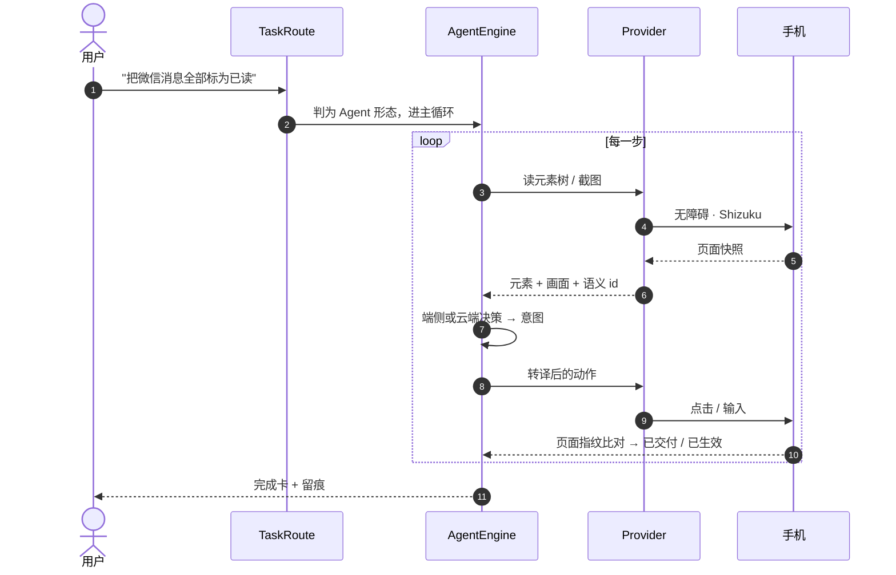

### Provider 与执行通道

[ProviderManager](app/src/main/java/com/phoneagent/device/provider/ProviderManager.kt) 是主应用侧门户，负责安装引导与版本比对、`bindService` 进 `IDeviceProvider`（3 秒超时 + 断连自动重绑），以及带超时兜底的远程调用。四个硬处理：

- **只有通道真死了才清代理**：`DeadObjectException` / `RemoteException` 才作废；`TransactionTooLargeException` 属于业务失败（回包过大），保留连接。
- **作废即真正解绑**：只清引用不解绑的话，系统认为连接仍活动，下次 `bindService` 不再回调——这正是「显示已连接但命令全发不出去」的成因。
- **大块数据分片**：截图与元素树走 `beginPayload` / `readPayload` / `endPayload`，单片 128 KB，避开 Binder 约 1 MB 的事务上限。
- **执行通道自检**：把「装没装 → 开没开 → 绑没绑 → 树能不能读 → 图能不能截 → Termux 三步」拆成可观察的步骤，每步给实际数值。

通道选择的唯一判据是 [ShellRules.pickChannel](app/src/main/java/com/phoneagent/engine/execution/ShellRules.kt)：

<p align="center">
  
  
</p>


| 通道 | 权限级别 | 能做什么 |
|---|---|---|
| 内置 Shizuku | shell（adb） | `am` / `pm` / `settings` / `input` 等系统命令 |
| ADB 引导会话 | shell（adb） | **不能**执行任何命令：只用于把内置 Shizuku server 拉起来，能力快照里最多算「降级」，对用户统一呈现为 Shizuku |
| Termux | **普通应用权限** | curl / python / jq / 文本处理，**不能**执行系统命令 |

Termux 的 `RUN_COMMAND` 权限、结果 PendingIntent 回传、`allow-external-apps` 判定全部在 Provider 内完成；主应用侧 [TermuxBridge](app/src/main/java/com/phoneagent/device/shell/TermuxBridge.kt) 只转发 AIDL 并暴露缓存状态。

### ShellCommands — AI 友好命令

自由模式下 AI 自写命令时不必记忆 ADB 语法。坐标支持三种写法：百分比（`50%`）、比例（`0.5`，严格小于 1 才视为比例）、像素（`500`）。

<details>
<summary><b>展开完整命令表（26 条，另有 <code>raw</code> 兜底透传）</b></summary>

| 命令 | 参数 | 说明 |
|---|---|---|
| `tap` / `lp` / `dt` | `x y` | 点击 / 长按 1500 ms / 双击 |
| `sw` | `x1 y1 x2 y2` | 滑动 |
| `su` / `sd` / `sl` / `sr` | `x y` | 方向滑动屏幕的 25%（至少 100 px） |
| `key` | `BACK/HOME/ENTER/RECENTS/MENU/VOLUME_UP/…/数字` | 按键 |
| `back` / `home` / `recents` | — | 系统键 |
| `text` | `"文字"` | 输入文字 |
| `am` / `launch` / `stop` / `dump` | 包名或组件名 | 启动 / 停止 / 列出 Activity（裸包名自动补成启动语义） |
| `info` / `window_size` / `battery` / `date` | — | 设备信息 |
| `clip` / `clipboard` | — | 读取剪贴板内容 |
| `brightness` | `0~255` | 屏幕亮度 |
| `screenshot` | — | 截图到 `/sdcard` |
| `wifi_on` / `wifi_off` | — | WiFi 开关 |
| `raw` | 完整 ADB 命令 | 直接透传（兜底） |

</details>

### 视觉链路

<p align="center">
  
  
</p>


| 来源 | 触发条件 | 产物 |
|---|---|---|
| 端侧 3B（GGUF + JNI） | 已下载、加载成功，且（未开混合路由或页面简单） | 控件类型 + 用途 + 归一化坐标 |
| 云端视觉模型 | 混合路由判为复杂页，或端侧不可用 | 截图文字描述 |
| ML Kit 中文 OCR | 前两者都没产出 | 文字区域聚类成控件 |

"页面复杂度"的判据是**元素树稀疏度**：`elements.size ≤ 3` 视为复杂页（无障碍读不到控件，需强语义理解），走云端；否则走端侧 3B。配套约束：主模型能否直接读图走三态（`AUTO` 听模型库真实探测 / `ON` / `OFF` 强制覆盖）；端侧 3B 原生层自带 120 秒推理看门狗，超时返回 `__ERR_TIMEOUT__` 由 Kotlin 侧回退 OCR；整条视觉链路有 25 秒外层看门狗；页面指纹 + 截图尺寸 + 任务 ID 命中时复用上一步视觉结果，整段跳过三路调用。

### 语义标注

[PageAnnotator](app/src/main/java/com/phoneagent/engine/perception/PageAnnotator.kt) 在每次观察后为 26 类常见控件分配稳定语义 id，注入上下文后 AI 可以直接 `target={by:"id",value:"send_btn"}`：

```text
dlg_allow / dlg_dismiss / ad_skip / back_btn / close_btn / search_box / search_btn / refresh_btn
send_btn / confirm_btn / checkout_btn / delete_btn / switch_toggle / select_box / more_btn / add_btn
next_btn / login_btn / share_btn / collect_btn / copy_btn / download_btn / upload_btn
settings_btn / sort_btn / clear_input
```

两条实现约束：元素特征一次性预计算（原实现按 26 个类别各扫一遍全量元素，长列表页会重复生成数千字符串）；`dlg_dismiss` 只在确认是真弹窗（存在正向按钮且元素 ≤ 8）时才标定，避免把普通页的「取消」误判成关闭弹窗。

### 提示词

[PromptCatalog](app/src/main/java/com/phoneagent/engine/prompt/PromptCatalog.kt) 是全项目提示词正文的唯一清单，60 个区块各带装配条件（`requires` / `excludes`），由 `PromptAssembler` 排序、拼接、整组一次性渲染占位符。

- **永不裁的安全块**：铁律、授权范围、禁止输出、能力声明（`safe = true`）。
- **按任务裁的两个大块**：非网页任务省掉「网页浏览」，非打开任务省掉「打开链接与文件」。
- **引导块**：语音助手、编码、对话三类只在明确命中时注入，未知任务不注入也不误导。
- 数组拼接时 `body + sep` 必须精确复现原文换行——`PromptSnapshotTest` 用金样本锁定，改 `sep` 就等于改提示词。

### 记忆体系

<p align="center">
  
  
</p>

| 类型 | 存储 | 用途 |
|---|---|---|
| 用户画像 | `MemoryStore` | 偏好、习惯，跨任务生效 |
| AI 记忆 | `MemoryStore`（去重合并） | 任务结束由模型提炼的长期事实 |
| 经验规则 | `EvolvedRule` | 带作用域的规则，按前台应用计数推断适用范围 |
| 异常经验 | `AnomalyMemoryEngine` | 同类页面异常的历史处置，命中即复用 |
| 任务记忆 | `MemoryStore`（`task_memory` 键） | 目标 / 需求 / 已验证方法 / 状态 / 步骤，容量 30 条 |
| 页面记忆 | `MemoryStore` | 页面控件空间树 + 热点，绘制纯线框虚拟手机画面 |

页面记忆会在屏幕上用淡色圆环标记已记忆控件（不挡触摸），并在决策提示里注入「这个页面可以从哪里去哪里」。

### 编码环境与编码 Agent

`:env`（targetSdk 28）承载 PRoot + Alpine 根文件系统，主应用经 `IEnvProvider` 驱动。[CodingEnvBootstrap](app/src/main/java/com/phoneagent/coding/env/CodingEnvBootstrap.kt) 把整条链路固化成可重复执行的流程：

```text
探测 → 装组件 → 全文件访问 → 组件存储授权 → Linux 根 → JDK 17 → Gradle
     → cmdline-tools → platform / build-tools → aapt2 兼容层 → assembleDebug
```

每次调用只推进到**第一个需要用户动手的环节**并拉起对应系统页面，返回 `needsUserAction`；用户办完重跑即可，已完成步骤不重复执行。两处硬约束在代码里显式处理：环境组件是另一个 uid，读不到主应用 `filesDir`，私有工作区先镜像到 `/storage/emulated/0/happyac-build/<工程名>`；aapt2 只有 x86_64 版，arm64 设备上由 `qemu-x86_64` + glibc 转译执行。

编码任务由内置 Node 宿主（`assets/agent-host`，随包）执行，与操控链路**彻底隔离**：独立会话 ID、独立工作区、独立状态目录（`<工作区>/.happyac/agent`，切工作区即切一整套记忆）。

- **工作区**：由 `CodingWorkspaces` 登记表决定（默认 `filesDir/workspaces/default`，也可指向共享存储），会话 / 记忆 / 用量 / 模型档位都跟着工作区走。
- **宿主桥**：`HostBridgeServer` 给 Node 侧暴露工作区文件、编辑器、预览，以及 `env_status` / `env_setup` / `env_build` / `env_cancel` 四个环境桥方法。
- **CA 对齐**：Node 自带 Mozilla CA 缺部分国内网关根证书，启动时把系统 CA 拼成 PEM 传给 `NODE_EXTRA_CA_CERTS`（叠加而非替换）。
- **随包技能**：`assets/skills/<name>` 首次使用时按 `skill.json` 的 version 落盘到 `filesDir/skills`，版本没变就跳过，不覆盖用户改动。
- **分享进来的文件**：docx / xlsx / pptx / zip 额外解析出纯文本摘录（同目录 `<名>.text.txt`），否则 `read_file` 读到的是二进制。

### 浏览器通道

9 个 `browse_*` 意图由内置 WebView 用 DOM 脚本落地，**与设备能力无关**（不依赖无障碍 / Shizuku / Termux），所以 AI 能"亲眼看到"网页内容。正文回传为 Markdown、链接内联为 `[文字](网址)`；抓回的 HTML 先嗅探转换再截断——顺序反过来的话，4000 字符常常停在 `<head>` 中段；元素点击优先按文字定位，无文字才用 CSS 选择器。回注预算与 shell 输出统一走 `AgentBudgets.REINJECT_MAX_CHARS`（4000）。

### 技能与 MCP

- **内置技能**：`SkillCatalog` 把每个意图登记成带参数描述的技能，`legacyIntent` 指回原意图名，`SkillCompat.normalize` 保证「AI 叫旧意图名 / 技能 id / 技能中文名」都落到同一条转译链路。
- **宏技能**：多步技能由端侧接力派发，派发前整宏预检（步骤存在且启用、意图类步骤过当前动作模式门控），任一步被拒则整宏不启动；运行期任一步失败即停并交还 AI。
- **MCP 技能**：远程 JSON-RPC 调用，单次 20 秒超时、输出截断 1200 字符、连续 3 次拒绝即收尾；市场条目只作快捷填充（公共 REST 站点不是 MCP 服务，需自建网关）。
- **缺参自动推断**：因缺必填参数被拒时，端侧先从历史成功参数 / 上一步结果 / 任务原文 / 页面文本推断补全，免去一轮追问。

### 安全防护

<p align="center">
  
  
</p>

| 机制 | 实现 |
|---|---|
| 敏感页只读 | `SensitivePageDetector` 识别支付 / 密码 / 验证码等关键词；连续 5 次接管仍敏感即收尾 |
| 数据脱敏 | 18 位身份证 → 16~19 位银行卡 → 11 位手机号，按长度降序掩码；少于 11 位数字走快速通道直接返回 |
| 不可逆动作确认 | `needsUserConfirmation` 的动作、目标控件命中危险词表的动作（含网页里按真实元素文字判，取不到控件时也问）、幂等判据要求复问的动作，执行前都问一次，120 秒超时视为取消；同一页面上同一动作 60 秒内不重复问，换页面必重新问 |
| 自由模式命令确认 | AI 自写命令（含 `terminal_op op=exec`）在本任务首次执行前确认一次，拒绝后回注「别重试这条」 |
| 外部入口确认 | 从 extras / 深链 / 分享文字进来的任务先过一次确认；只有来源可证是本应用自己发起的才免问（`EntryTrust`，取不到调用方 uid 一律按外部处理） |
| 幂等保护 | 只认本任务内的执行历史：同一动作已下发、且页面仍显示完成确认句才跳过重复副作用（提交 / 发送 / 下单 / 支付 / 删除）；只有页面文字像「做完了」而本任务没做过时，转确认门问一次 |
| 密钥存储 | `SecretCodec` 加密后再落 DataStore |

## 🖼 界面

> 真机截图，浅色 / 深色各一套。全部在 [docs/ui-shots/](docs/ui-shots/) 下。

<table>
  <tr>
    <td align="center">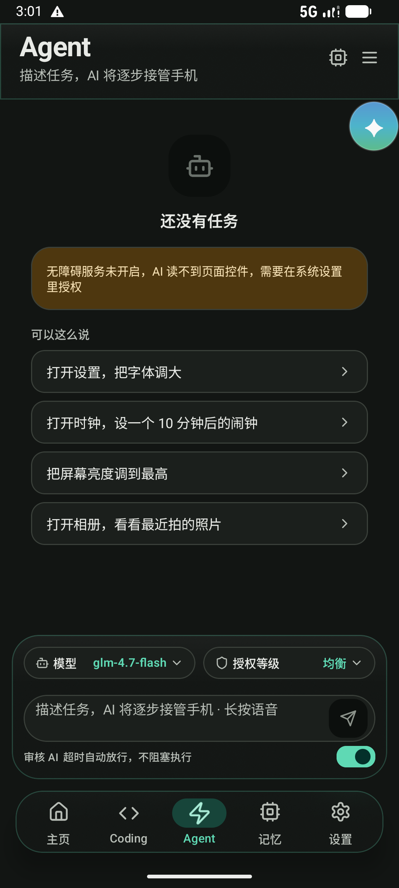<br><sub>主页 · Agent</sub></td>
    <td align="center">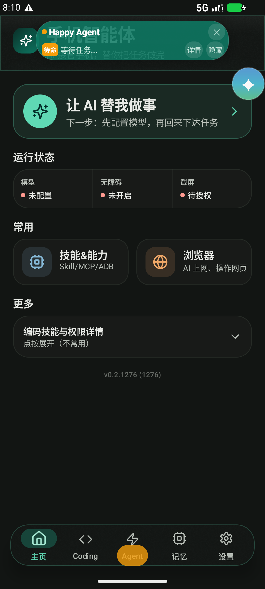<br><sub>执行中的任务卡</sub></td>
    <td align="center">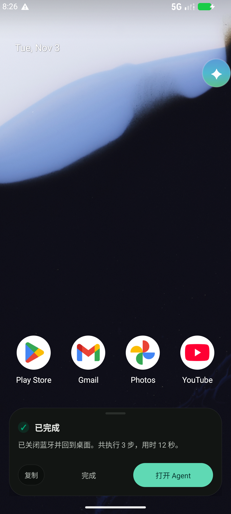<br><sub>完成结果卡</sub></td>
    <td align="center">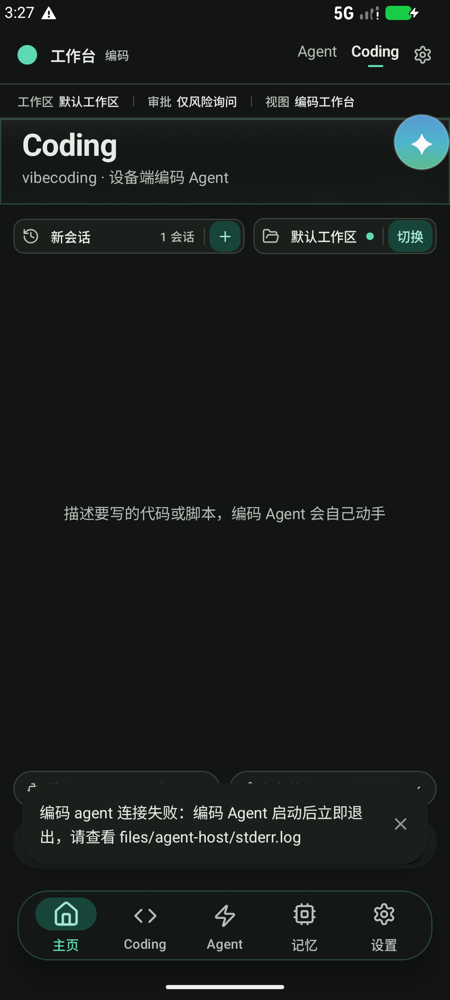<br><sub>Coding · 深色</sub></td>
    <td align="center">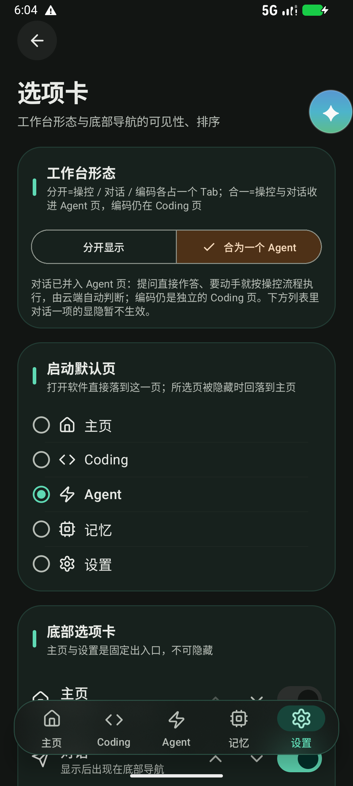<br><sub>设置 · 深色</sub></td>
  </tr>
  <tr>
    <td align="center">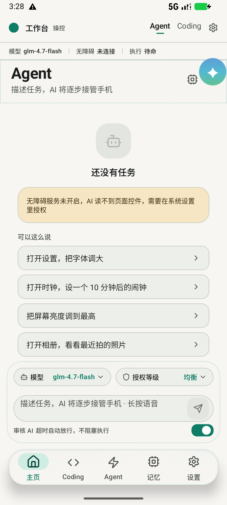<br><sub>Agent 工作台 · 浅色</sub></td>
    <td align="center">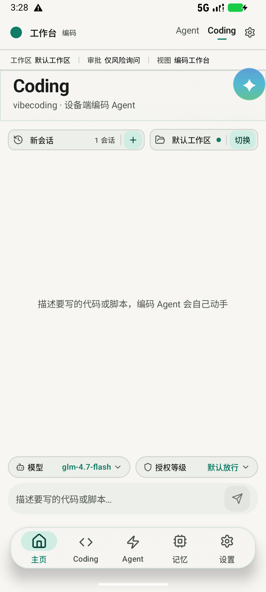<br><sub>Coding · 浅色</sub></td>
    <td align="center">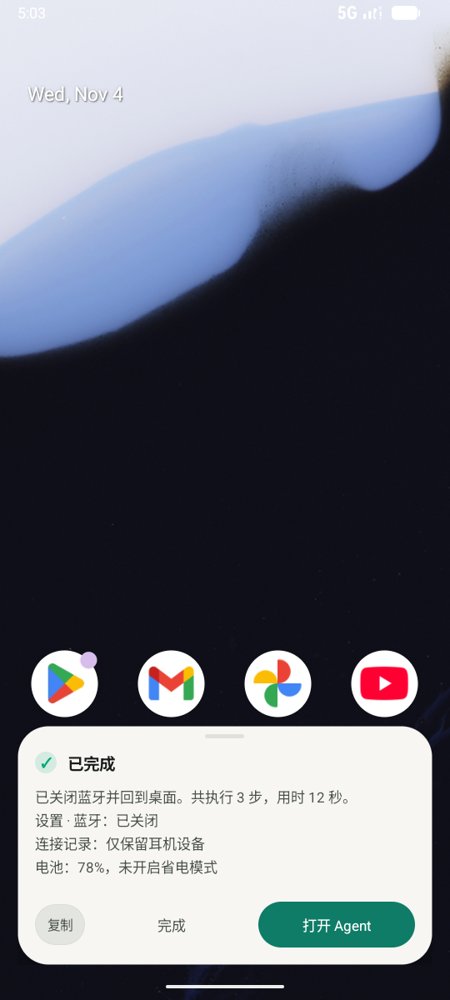<br><sub>悬浮窗完成卡</sub></td>
    <td align="center">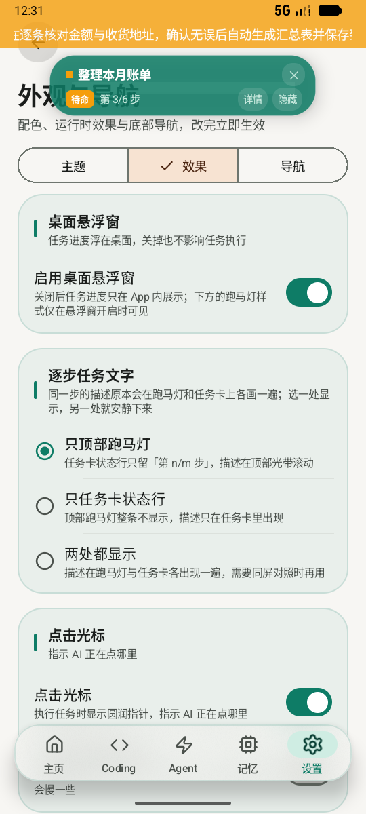<br><sub>外观与效果</sub></td>
    <td align="center">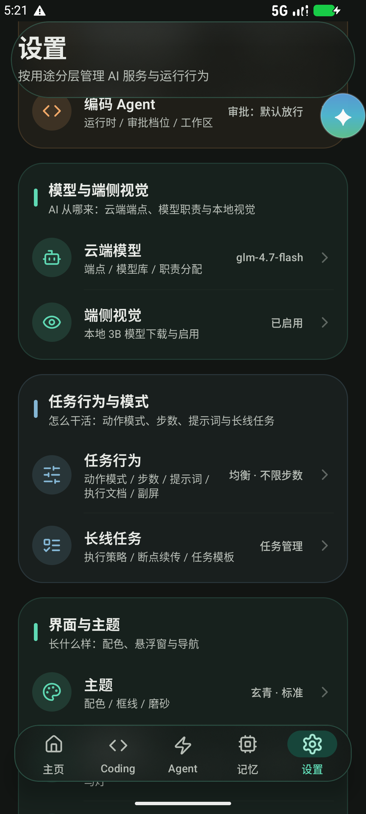<br><sub>四套色板</sub></td>
  </tr>
</table>

不想装设备先看界面：直接打开 [promo/app.html](promo/app.html)——一份**零依赖单文件**的交互式复刻，浏览器双击即开，图标与插画全为内联 SVG，不联网、不引 CDN。

应用被装进 412×892 逻辑屏（434×914 机身 + 圆角 + 侧键 + 指示条），窗口变化只做整机等比缩放。覆盖主页、对话、编码、操控（计划审批 / 执行 / 完成）、记忆图谱与页面记忆下钻、设置全套二级页、技能与 MCP、内置浏览器、文档阅读、测试工作台、调试页，以及开屏引导、协助浮层、不可逆动作确认卡、语音录入浮层。跟随系统深浅色，四套色板（玄青 / 赭石 / 黛蓝 / 绛紫）在「设置 → 主题」即时切换。设计令牌取自 `Color.kt` / `Theme.kt` / `Type.kt` / `Motion.kt`，与 Compose 源码一一对应。

同目录下 `promo/index.html`、`promo/ui-film.html` 是宣传片分镜页面（演示视频不入库）。

## 🔧 配置

设置分三层：设置主页 → 分类详情 → 二级页。分类为 AI 接入（云端模型 / 端侧视觉）、编码 Agent、运行行为（提示词与长线任务）、设备接入（权限与执行通道）、外观（主题 / 界面效果 / 底部选项卡）、系统（数据与存储 / 软件更新 / 关于与帮助）。

### 模型配置

| 模型职责 | 用途 | 默认 | 必需 |
|---|---|---|---|
| 主模型 | 每步决策、意图理解、对话直答 | `glm-4.7-flash` | ✅ |
| 视觉模型 | 截图描述、坐标定位 | `glm-4.6v-flash` | 可选 |
| 思考模型 | 规划、歧义检测、重规划 | `glm-4.7-flash` | 可选 |

端点（Base URL + Key）与模型分离管理，能力徽章来自真实请求探测；「职责分配」把模型绑到主 / 视觉 / 思考三个槽位。链路聚合默认关闭，开启后思考模型参与复杂规划。任意 OpenAI 兼容端点都能接，默认指向智谱开放平台。

### 其他关键开关

| 设置项 | 默认 | 说明 |
|---|---|---|
| `executionChannel` | AUTO | AUTO / SHIZUKU / TERMUX；历史 `ADB` 值读取时归一为 AUTO |
| `actionMode` | BALANCED | CONSERVATIVE / BALANCED / FREE |
| `attachScreenshot` | 开 | 每步附送截图给模型 |
| `enableExternalVision` | 开 | 启用端侧 3B |
| `smartVisionRoute` | 开 | 混合路由：简单任务走端侧，复杂任务走云端 |
| `pageMemoryEnabled` | 开 | 页面记忆 + 屏幕热点标记 |
| `floatingWindowEnabled` | 开 | 悬浮窗（关闭不影响任务执行） |
| `enableReview` | 开 | 独立审核者 AI 复核每步动作是否基于页面证据 |
| `virtualDisplayEnabled` | 关 | 副屏模式：任务在模拟显示上运行，不抢用户前台（需 Shizuku） |
| `promptLanguage` | CN | 提示词语言（中文 / 英文） |

## 🚪 入口

| 入口 | 实现 |
|---|---|
| 应用主界面 | 可配置 Tab：主页 / 对话 / 编码 / 操控 / 记忆 / 设置。默认「合并形态」下对话并入 Agent 页，由云端判定的意图自动选择直答还是操控；切到「分隔形态」则对话独立占位 |
| 桌面悬浮窗 | `FloatingWindowService` — 计划批准、歧义澄清、手动指导、任务停止 |
| 系统通知 | `TaskProgressNotifier` 任务进度 + `ActiveNotifier` 主动反馈（卡顿 / 死循环 / 模板失效） |
| 桌面 Widget | `AgentStatusWidgetProvider` — 任务名 + 状态 + 步数 |
| 快捷设置磁贴 | `AgentTileService` — 一键唤起 / 收起悬浮窗与任务 |
| App Shortcuts | 静态快捷方式（新建任务 / 继续上次 / 打开记忆）+ App Actions `GET_THING` 语音直达 |
| 分享目标 | `ACTION_SEND` / `ACTION_SEND_MULTIPLE` / `ACTION_PROCESS_TEXT` / `ACTION_VIEW` |
| 系统数字助理 | `HpaVoiceInteractionService` — 长按电源键 / 边缘手势唤起，带屏带电回到 Agent 页 |
| 语音输入 | 系统 `SpeechRecognizer` 或配置的 OpenAI 兼容转写端点 |
| 外部广播 | `TaskControlReceiver` — 供 Tasker / MacroDroid 等下发任务（默认关闭，需口令校验） |

## ❓ 常见问题

<details>
<summary><b>需要 Root 吗？要不要单独装 Shizuku？</b></summary>

都不需要。Provider 里内嵌了 Shizuku server，由 `app_process` 以 shell uid 拉起，因此免装官方 App；没有 Shizuku 的环境会退回无线 ADB 引导会话，再不行还有 Termux 这条普通应用权限的通道。

</details>

<details>
<summary><b>它会不会乱点、误付款？</b></summary>

四道闸：动作模式限制 AI 能提哪些请求（默认均衡档，支付/删除类属于自由档专属）；不可逆动作执行前必问——`needsUserConfirmation` 标了的、目标控件文字命中危险词表的、以及幂等判据拿不准的，都走同一张确认卡，网页里的点击按真实元素文字判（只读档直接拒绝，其它档改确认）；同一页面上同一动作 60 秒内不重复问，换页面（例如「点结算」再「点确认支付」）会各问一次；敏感页（支付 / 密码 / 验证码）只读，连续 5 次接管仍敏感即收尾。本任务内已下发过同一动作、且页面仍显示完成确认句时，才会跳过重复副作用。

</details>

<details>
<summary><b>能用哪些模型？必须联网吗？</b></summary>

任何 OpenAI 兼容端点。规划与决策需要云端模型，但视觉可以完全走端侧 3B + ML Kit OCR；端侧 3B 只影响"看不看得懂页面"，不替代决策模型。

</details>

<details>
<summary><b>为什么是两个 APK？</b></summary>

权限收敛。无障碍、Shizuku、Termux 都需要高权限能力，把它们关进独立进程后，主应用即便被审计也看不到一行权限代码；编码环境（`:env`）单独拆出则是因为它必须 targetSdk 28 才能 `execve` 私有目录里的程序。

</details>

<details>
<summary><b>为什么 README 里的数字能信？</b></summary>

因为它们是脚本从代码里数出来的（文件数、`@Test` 数、意图数、detekt 基线分布），改动代码后 CI 的基线守卫与 `CapabilityRegistryTest` 会先变红，文档跟着改。

</details>

## 📚 文档

仓库内 `docs/` 是**权威源**，[Wiki](https://github.com/xkx121029/Phtomt/wiki) 是对外门户、内容从这里提炼。索引见 [docs/README.md](docs/README.md)。

| 想了解 | 读这里 |
|---|---|
| 顶层目录、模块依赖、版本号流向 | [docs/project-structure.md](docs/project-structure.md) |
| 14 个模块的职责与依赖关系 | [docs/build-modules.md](docs/build-modules.md) |
| CI 触发、产物、补挂与排查 | [docs/release-pipeline.md](docs/release-pipeline.md) |
| 助理角色边界 | [docs/assistant-role-contract.md](docs/assistant-role-contract.md) |
| 任务降级提示的出口与文案 | [docs/task-notice-contract.md](docs/task-notice-contract.md) |
| 虚拟副屏方案与限制 | [docs/virtual-display-design.md](docs/virtual-display-design.md) |
| 品牌 VI / 界面改版 / 主题交接 | [docs/brand-vi.md](docs/brand-vi.md) · [docs/ui-refresh-plan.md](docs/ui-refresh-plan.md) · [docs/ui-theme-handoff.md](docs/ui-theme-handoff.md) |

<details>
<summary><b>设计与复盘长文（<code>杂项/</code>）</b></summary>

| 文档 | 内容 |
|---|---|
| [项目完整流程说明.md](杂项/项目完整流程说明.md) | 全局架构总览：感知 / 决策 / 执行 / 视觉 / 持久化 / 展示六层 |
| [HPA动作执行逻辑优化文档.md](杂项/HPA动作执行逻辑优化文档.md) | 意图 DSL（intent / target{by,value}）与执行层转译规范 |
| [IntentTranslator转译层原理.md](杂项/IntentTranslator转译层原理.md) | 意图 → 动作矩阵转译、通道选择 |
| [IntentTranslator_Bug分析.md](杂项/IntentTranslator_Bug分析.md) | 转译层历史 Bug 复盘与根因分析 |
| [HPA中长线任务优化及agent逻辑优化文档.md](杂项/HPA中长线任务优化及agent逻辑优化文档.md) | 长线任务进度记忆、检查点、防死循环、模板机制 |
| [HPA项目AI提示词全集.md](杂项/HPA项目AI提示词全集.md) | 全部提示词汇总（中文 / 英文双版本） |
| [HPA项目ai温度文档.md](杂项/HPA项目ai温度文档.md) | 各提示词 temperature 取值依据 |
| [HPA系统级集成可发展项目清单.md](杂项/HPA系统级集成可发展项目清单.md) | 14 项系统级集成点的调研与落地状态 |
| [HPS ai标准化测试.md](杂项/HPS%20ai标准化测试.md) | 提示词标准化测试方案与实测结果 |

</details>

## 🗓 版本与更新

完整变更记录见 [CHANGELOG.md](CHANGELOG.md)（遵循 Keep a Changelog + 语义化版本）。自动更新走官网 `GET {baseUrl}/api/update/check?channel=<stable|beta|dev|nightly>`，默认站点 `https://hpa.linshuxu.us.kg`；安装优先经内置 Shizuku 静默完成，不可用时退回系统安装器。发版链路见 [docs/release-pipeline.md](docs/release-pipeline.md)。

## 🤝 贡献

1. Fork 本仓库，从 `main` 切特性分支（`git checkout -b feature/xxx`）。
2. 提交信息遵循 Conventional Commits。
3. 推送并发起 Pull Request——CI 会把上面那条质量闸门完整跑一遍。

代码约定：

- 遵循 [Kotlin 官方编码规范](https://developer.android.com/kotlin/style-guide)，4 空格缩进。
- 分层依赖单向：`core` / `domain` 在最底层，不得反向依赖 `engine` / `device` / `ui`；`engine` 内部按子包拆分，主类只留主循环骨架。
- **新增能力只改两处**：`CapabilityRegistry` 加一条 `CapabilitySpec`；若产生设备动作，再在通道阶梯表加一行目标。名称、分类、风险档、技能目录与提示词一致性全部派生，`CapabilityRegistryTest` 与 `ActionMode.missingTiers()` 会拦住漏登。
- 新增提示词区块只在 `PromptCatalog` 登记，正文放 `PromptBodies`。
- UI 变更遵循 Material 3 Expressive，配色与形状取值以 [docs/brand-vi.md](docs/brand-vi.md) 为准。
- 不留死代码：README 或注释里提到、代码中已不存在的类名，视为 bug。

## 📄 许可

本项目基于 [GNU Affero General Public License v3.0](LICENSE)（AGPL-3.0）开源。

这意味着：

- 你可以自由使用、修改、分发本项目，但**分发修改版时必须同样以 AGPL-3.0 开放源码**；
- 如果你把修改版**作为网络服务提供给他人使用**（AGPL 第 13 条），也必须向使用者提供完整源码；
- 分发时必须保留本项目的版权声明与许可证文本，以及 `LICENSE` 末尾列出的第三方声明。

早期版本（含已发布的历史 Release）在发布时按 MIT 许可分发，那些副本仍适用 MIT；自本许可证变更后的版本适用 AGPL-3.0。如需商业授权或豁免，可联系仓库维护者。

第三方组件（Shizuku、Node.js 运行时、ICU 等）仍适用各自许可证，详见 [`LICENSE`](LICENSE) 末尾的第三方代码声明与 [`ACKNOWLEDGEMENTS.md`](ACKNOWLEDGEMENTS.md)。

## 🙏 致谢

- Material Design 团队、Jetpack Compose 社区、Google ML Kit
- [Shizuku](https://github.com/RikkaApps/Shizuku) — 权限通道的底层实现（vendor 至 `third_party/shizuku`）
- [Coda](https://github.com/happy-everyday-everyweek/coda) — 安卓端 Agent 工具，工程组织与运行时方案提供了参考（AGPL-3.0）
- [MobileGym](https://github.com/Purewhiter/mobilegym) — 可验证、高并行的移动 GUI Agent 研究平台，任务设计与验证思路参考（Apache-2.0）
- [Aether（扶摇）](https://github.com/Zhou-Shilin/Aether) — 进行中状态回显（过程弱化、结果成卡、微光扫过文字）借鉴其层次处理手法（GPL-3.0）
- 以及所有开源贡献者

---

<div align="center">

<sub>把重复操作交出去，把注意力收回来。</sub>

<br><br>

<a href="https://github.com/xkx121029/Phtomt/stargazers"></a>
<a href="https://github.com/xkx121029/Phtomt/issues/new/choose"></a>
<a href="https://xkx121029.github.io/Phtomt/"></a>

<br><br>

<sub>墨 · 纸 · 萤 · 格 ——「亮格」</sub><br>
<a href="https://github.com/xkx121029/Phtomt#readme">回到顶部 ↑</a>

</div>
