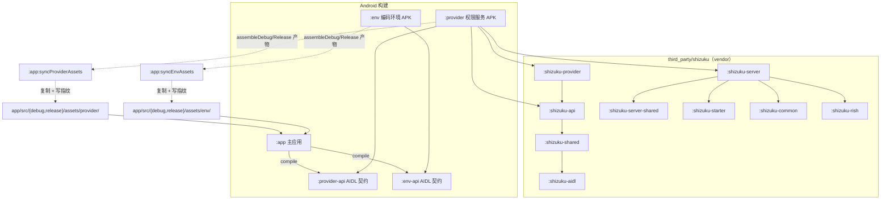

# 仓库结构地图（Happy Phone Agent / Phtomt）

> 面向第一次接手本仓库的人：先看「30 秒速览」，再按需查目录表与依赖图。
> 最后核对日期：2026-11-11。凡与本文件不一致的地方，以 `settings.gradle.kts`、`build.gradle.kts`、`.github/workflows/` 为准。

---

## 30 秒速览

- **本仓库 = 一个 Android 工程**（主应用 `:app`）+ **两个独立 APK 组件**（`:provider` 权限服务、`:env` 编码环境）+ **vendor 进来的 Shizuku 源码** + **官网** + **推广物料**。
- **训练器不在本仓库**：它在 `D:/mobilegym_test`（`hpa_training/` + `bench_env/`）。本仓库只保存训练器的部署脚本、报告与快照证据。
- **版本号只有一个计数器**：根目录 `version.properties` 的 `BUILD_NUMBER`。本机构建、CI、发布技能都读写它。
- **APK 产物**：`app/build/outputs/apk/debug/app-debug.apk`（原始）→ 归档到 `build/apk-archive/`，手工交付副本放 `coda-apk-output/`（不入库）。
- **别手改**：`app/src/main/assets/agent-host/`（上游同步生成）、`app/src/main/jniLibs/`（脚本生成但必须入库）。

---

## 一、顶层目录树

标记：`[源]` 源码 / `[产]` 构建或运行产物 / `[本]` 只在本机、不入库 / `[史]` 历史遗留 / `[外]` 外部同步或 vendor

```
happy_phone agent/
├── app/                      [源] Android 主应用（Kotlin + Compose）
│   ├── build.gradle.kts      版本号读取、签名、资产同步、单测/门禁配置
│   ├── src/main/             业务源码 / 资源 / agent-host / skills / jniLibs
│   ├── src/debug|release/    渠道资产（provider.apk、env.apk 同步落点）
│   └── src/test/             JVM 单测 + 提示词 golden
├── provider/                 [源] 权限 Provider 独立 APK（无障碍 / 内置 Shizuku / Termux 通道）
├── provider-api/             [源] 主应用 ↔ Provider 的 AIDL + Parcelable 契约
├── env/                      [源] 编码环境独立 APK（targetSdk 28，承载 PRoot + Alpine）
├── env-api/                  [源] 主应用 ↔ env 组件的 AIDL 契约
├── third_party/shizuku/      [外] vendor 的 Shizuku 客户端 + server 源码（8 个 Gradle 模块）
├── config/                   [源] detekt 基线、可选构建模块开关、Provider 资产指纹
├── gradle/                   [源] version catalog（libs.versions.toml）+ wrapper
├── tool/                     [源] 维护脚本：agent-host 打包、运行时 so 打包、Gitee 补传等
├── tests/                    [史] 提示词 / ADB 的 Node 测试脚本（不在 Gradle 任务图内）
├── docs/                     [源] 项目文档、UI 证据帧、训练器文档与快照
│   ├── hpa-trainer/          训练器部署脚本 / 报告 / 线上快照（见第五节）
│   ├── ui-shots/             UI 走查证据帧（局部 .gitignore 控制入库范围）
│   └── refactor/             重构方案
├── website/                  [源] Vue3 官网 + Express 内容 API（CI 发 GitHub Pages）
├── promo/                    [源] 推广 HTML 演示页 + 真机截图
├── promo-video/              [源] Remotion 推广视频工程（素材入库，成片不入库）
├── 杂项/                      [史] 早期提示词文档、诊断日志、图标设计稿
├── BUGS/                     [本] 历史缺陷与排查报告（已被 .gitignore，仅本机）
├── build/                    [产] 根构建产物：apk-archive、build-info、缓存（忽略）
├── .gradle/ .kotlin/         [产] 本机 Gradle / Kotlin 缓存（忽略）
├── coda-apk-output/          [本] 手工构建的 APK 交付暂存（未入库）
├── .gitee-cache/             [本] Gitee 发行版附件补传缓存（忽略）
├── .screenshots/             [本] 整机 / 平板截图工作区（忽略）
├── .trae/                    [本] 本仓库专用技能（hpa-publish、android-build-apk）与设计文档（忽略）
├── .workbuddy/               [本] 协作 agent 的每日记忆（忽略）
├── .githooks/                [源] 身份闸门（pre-commit）+ 提交后推 nightly（post-commit）
├── .github/workflows/        [源] Android CI（beta/dev 发布）+ 官网 Pages
├── build.gradle.kts          [源] 根构建：版本号、构建锁、可选模块（android/vue/git/github）
├── settings.gradle.kts       [源] 模块图（唯一权威）
├── gradle.properties         [源] JVM / 并行 / 增量编译开关
├── version.properties        [源] 版本计数器（唯一的 versionCode 来源）
├── local.properties          [本] 本机 SDK 路径（忽略）
├── README.md / CHANGELOG.md / LICENSE / ACKNOWLEDGEMENTS.md
└── (根目录临时文件)           日志 / 崩溃转储 / 截图，见第七节清理记录
```

### 根目录历史文档（不在 `docs/`）

| 文件 | 性质 | 说明 |
| --- | --- | --- |
| `架构统一性审计报告.md` | [史] 审计报告 | 被 `docs/作品说明-评委版.md` 以**裸文件名**引用，暂不移动 |
| `性能优化与重构报告-2026-10-27.md` | [史] 审计报告 | 同上 |
| `代码审查与优化建议-2026-10-28.md` | [史] 审计报告 | 同上 |
| `Screenshot_1793817324.png`、`Screenshot_1793818511.png` | [史] 真机截图 | 全仓无引用，疑似无人使用（未删，待确认） |

---

## 二、`app/` 内部结构

`app/src/main/java/com/phoneagent/`（335 个 Kotlin 文件、87,219 行；单测另有 115 个文件 / 1189 个 `@Test`）：

| 包 | 职责 | 典型内容 |
| --- | --- | --- |
| `coding/` | 设备内编码 Agent（Node host 进程、运行时引导、技能） | `AgentProcess`、`RuntimeBootstrap`、`HostBridgeServer` |
| `core/` | 横切能力 | `ai/` 模型客户端与结构化输出、`security/`、`log/`、`notify/`、`perf/`、`text/`、`window/` |
| `data/` | 持久化 | `prefs/`（AppSettings）、`store/`、`export/` |
| `device/` | 设备能力 | `a11y/` 无障碍快照、`provider/` 通道管理、`capability/` 能力探测、`perception/`、`screen/`、`shell/`、`vision/`、`clock/`、`ops/` |
| `domain/` | 纯模型与规则 | `model/`（AgentAction、CapabilitySpec 等）、`rules/` |
| `engine/` | ReAct 主循环与执行 | `loop/`、`planning/`、`decision/`、`execution/`、`prompt/`、`memory/`、`context/`、`docs/`、`perf/`、`skill/`、`runtime/` |
| `feature/` | 面向功能的能力模块 | `assistant/`、`browser/`、`mcp/`、`skill/`、`task/`、`voice/`、`agentdoc/`、`document/`、`notify/`、`update/`、`adskip/`、`edge/`、`entry/`、`test/` |
| `overlay/` | 悬浮窗 / 底部胶囊 / 结果卡 | `FloatingWindowService` 等 |
| `ui/` | Compose 界面 | `home/`、`agent/`、`chat/`、`coding/`、`settings/`、`workbench/`、`theme/`、`onboarding/`、`browser/`、`memory/`、`skill/`、`voice/`、`debug/`、`icons/`、`components/` |
| `di/` | Koin 依赖注入 | `AppModule` |

`app/src/main/assets/`：

| 目录 | 职责 | 维护方式 |
| --- | --- | --- |
| `agent-host/` | 设备内 Node 编码 host（`host-stdio.js`、`agent.js`） | **由 `tool/bundle_host.mjs` 从上游单向同步生成，不手改；必须入库**（CI 没有上游检出） |
| `skills/happyac-coding/` | 内置编码技能（`skill.json` + `prompt.md`） | 手改 |
| `editor/` | 内置编辑器前端资源 | 手改 |

`app/src/main/jniLibs/arm64-v8a/`：Node / ICU / llama / ggml 等运行时 so。由 `tool/bundle_runtime.py` 生成，`.gitignore` 末尾单独豁免后**必须入库**；缺任一个 CI 会硬断言失败。

`app/src/{debug,release}/assets/`：

| 路径 | 是否入库 | 来源 |
| --- | --- | --- |
| `provider/version.txt` | 是 | 手改（通道版本标记） |
| `provider/provider.apk` | 否 | `:app:syncProviderAssets` 从 `:provider` 产物复制 |
| `env/version.txt` | 否（目录被忽略） | `:app:syncEnvAssets` 生成 |
| `env/env.apk` | 否 | `:app:syncEnvAssets` 从 `:env` 产物复制 |

> 干净检出后 provider/env 的 APK 都不存在，必须先跑 `syncProviderAssets` / `syncEnvAssets`（CI 已这样做）。

---

## 三、模块依赖图



要点：

1. **`:app` 不依赖 `:provider` / `:env` 模块本身**，只依赖两个 `*-api` 契约模块，并在运行时从 assets 里安装/拉起对方的 APK。
2. **Shizuku 只被 `:provider` 使用**。主应用不再直接引用 `rikka.shizuku` API（`app/build.gradle.kts` 有注释说明）。
3. Provider / env 的 APK 是「构建产物提交进仓库」的资产（provider）或「构建时生成」（env）。改了源码必须重新同步，否则 `verifyProviderAssets` 会拦下构建。

纯文本版：

```
settings.gradle.kts
├── :app            → :provider-api, :env-api
├── :provider       → :provider-api, :shizuku-api, :shizuku-provider, :shizuku-server
├── :provider-api   （AIDL + Parcelable）
├── :env            → :env-api
├── :env-api        （AIDL）
└── third_party/shizuku
    ├── :shizuku-provider → :shizuku-api
    ├── :shizuku-api      → :shizuku-shared
    ├── :shizuku-shared   → :shizuku-aidl
    └── :shizuku-server   → :shizuku-server-shared, :shizuku-starter, :shizuku-common, :shizuku-rish
```

---

## 四、版本号与产物：从哪来到哪去

### 4.1 版本计数器

```
                        ┌──────────────────────────────┐
                        │ 根目录 version.properties     │
                        │ BUILD_NUMBER=9185             │
                        └──────────────┬───────────────┘
                                       │
        本机构建 ┌─────────────────────┼─────────────────────┐ CI 构建
                 ▼                     ▼                     ▼
   root build.gradle.kts        :app / :provider      .github/workflows/android-ci.yml
   - -PbuildNumber 优先          versionCode = N       从 nightly 分支读计数 → +1
   - 仅在产出 APK 时 +1          versionName = 0.2.N   -PbuildNumber=N 注入构建
   - package 成功后回写          → 打进 APK            tag = v0.2.N-{beta|dev}
                 │                                      构建成功后再回写 nightly
                 ▼
      .trae/skills/hpa-publish/scripts/publish.mjs
      读 version.properties → 上传官网后台 → beta 渠道
      （android-build-apk 技能每次构建后自动发 dev）
```

必须知道的约束：

- **版本号只增不减**：基线取 `max(已记录值, git 提交数)`，回退会导致覆盖安装失败。
- **只有真正产出 APK/AAB 的任务才自增**：跑 detekt / test / syncProviderAssets 不吃号；`--dry-run` 也不吃号。
- **CI 的权威副本在 nightly 分支**：beta 与 dev 共用一条计数器序列，所以 CI 并发组是全局的（不按分支）。
- 本地构建会让 `version.properties` 变脏（这是设计行为，不是误改）。

### 4.2 产物落点

| 产物 | 路径 | 谁生成 | 是否入库 |
| --- | --- | --- | --- |
| Debug APK（原始） | `app/build/outputs/apk/debug/app-debug.apk` | `:app:assembleDebug` / CI | 否 |
| APK 版本元数据 | `app/build/outputs/apk/debug/output-metadata.json` | AGP | 否 |
| 时间戳归档 APK | `build/apk-archive/app-debug_<yyyyMMdd_HHmmss>.apk` | `androidPackage`（开关见 `config/build-modules.properties`） | 否 |
| 手工交付 APK | `coda-apk-output/*.apk` | 人工 / 历史构建 | 否（本机） |
| 官网种子 APK | `website/public/apk/*.apk` | `website/scripts/seed.mjs` | 否 |
| 官网静态站 | `website/dist/`、`website/dist-static/` | `npm run build` / `build:static` | 否 |
| 推广视频成片 | `promo-video/out/`、`promo/*.webm` | Remotion / 录屏 | 否 |
| 单测/静态检查报告 | `app/build/reports/` | Gradle | 否（CI 作为 artifact 上传） |

### 4.3 构建相关入口

| 入口 | 用途 |
| --- | --- |
| `./gradlew :app:assembleDebug` | 常规出包 |
| `./gradlew :app:syncProviderAssets :app:syncEnvAssets` | 干净检出 / 改过组件后必须先跑 |
| `./gradlew androidCheck` | JDK 17+ / SDK 36 / wrapper 前置校验 |
| `./gradlew androidPackage` | 出包 + 时间戳归档 |
| `./gradlew :app:detekt` / `:app:checkDetektBaseline` | 静态检查 / 基线只减不增守卫 |
| `./gradlew :app:testDebugUnitTest` | JVM 单测 |
| `python tool/bundle_runtime.py`、`node tool/bundle_host.mjs` | 刷新编码运行时 / agent-host |
| `python tool/gitee_attach.py` | 局域网侧把 APK 补挂到 Gitee 发行版 |

---

## 五、与训练器的边界（重要）

**训练器代码不在本仓库，也不要往本仓库搬。**

```
D:/mobilegym_test/                 ← 训练器真实源码（Python，独立仓库/目录）
├── hpa_training/                  训练主循环、策略、进化、runner
├── bench_env/                     评测环境（MobileGym / judge 侧）
├── Dockerfile / docker-compose.yml
└── dist/、apps/（-WithStatic 时才同步）

D:\xkx\xkx_appproj\happy_phone agent\docs\hpa-trainer\   ← 本仓库只放「接口 + 证据」
├── deploy_hpa.ps1                 SourceRoot 默认 D:\mobilegym_test；整目录同步 + md5 三方对账
├── watch_gen17.ps1 / watch_stop_at_rollout.ps1
├── check_*.py / replay_guard.py   线上健康 / 守卫校验
├── upload_agent_docs.py           把提示词文档推到训练侧
├── 任务文档v2-格式与接口.md        训练器 ↔ 本仓库的唯一接口约定
├── 训练问题修复报告-2026-11-03.md  改动清单与部署记录
├── PROBES.md                      探针记录
└── snapshots/                     线上配置/事件/摘要快照（证据，入库）
```

耦合方式只有两种：

1. **部署脚本同步**：`deploy_hpa.ps1` 从 `D:\mobilegym_test` 读取 `hpa_training`、`bench_env`、`Dockerfile`、`docker-compose.yml`、`.dockerignore`，同步到 NAS `/volume1/docker/hpa-trainer/build` 并逐文件 md5 对账。
2. **文档/提示词上传**：`upload_agent_docs.py` 把本仓库的提示词/任务文档推到训练侧。

因此：

- 本仓库的 `docs/hpa-trainer/` **不是**训练器源码，改它不会改变训练逻辑，只影响部署/取证/文档。
- 训练器那边的 `hpa_training/`、`bench_env/` 改动**不要**在本仓库提交。
- 修改 `deploy_hpa.ps1` 的 `SyncTrees` / `BuildFiles` 会直接影响部署完整性；Dockerfile 的每个 `COPY` 源必须落在同步范围内（脚本会自检）。
- 两边唯一的“版本对账”靠 md5 和 `任务文档v2-格式与接口.md`，没有代码级依赖。

---

## 六、改动影响面（改前先查这张表）

| 你要改 | 会影响到 | 注意 |
| --- | --- | --- |
| `settings.gradle.kts` | 全部 Gradle 模块、CI、IDE 导入 | 模块目录名是硬编码的，改名前先全局搜 `project(":` |
| 根 `build.gradle.kts` | 版本号、构建锁、可选模块任务 | 任务动作不能引用脚本对象（配置缓存限制）；动了版本逻辑要同时核对 CI 的断言 |
| `app/build.gradle.kts` | APK 产物、签名、资产同步、detekt 基线 | 改 `versionCode` 来源会破坏 CI 的 tag 对齐断言 |
| `version.properties` | 本机与 CI 的 versionCode、发布技能 | 只增不减；CI 以 nightly 为权威副本 |
| `app/src/main/assets/agent-host/` | 设备内编码 Agent | 由上游生成，手改会在下次同步被覆盖；必须入库 |
| `app/src/main/jniLibs/` | 编码运行时 | 必须入库；CI 对 `libnode.so`、ICU 硬断言 |
| `provider/`、`provider-api/` | Provider APK + 主应用契约 | 改完跑 `:app:syncProviderAssets`，否则 `verifyProviderAssets` 拦截 |
| `env/`、`env-api/` | 编码环境 APK + 契约 | 改完跑 `:app:syncEnvAssets` |
| `config/provider-assets/*.sha256` | 构建门禁 | 由 `syncProviderAssets` 自动重写，不要手改 |
| `config/detekt/baseline.xml` | CI 基线守卫 | 只减不增（`checkDetektBaseline` 会失败） |
| `docs/hpa-trainer/deploy_hpa.ps1` | NAS 上的训练器部署 | 只影响部署，不影响本仓库构建 |
| `website/` | GitHub Pages、官网下载数据 | CI 路径写死 `website/**`；`dist`、`node_modules` 不入库 |
| `.github/workflows/` | 发布链路 | 改版本/签名/产物名要同步改断言，否则发布红 |
| `.githooks/post-commit` | 每次提交后的自动推送 | 当前只对 `remote.gitee` 生效；没有该 remote 时直接退出 |

---

## 七、产物 / 临时目录与 .gitignore

### 7.1 已正确忽略

| 路径 | 规则 | 说明 |
| --- | --- | --- |
| `build/`、`app/build/` | `build/` | 根与模块构建产物 |
| `.gradle/`、`.kotlin/` | 同名规则 | 本机缓存 |
| `.gitee-cache/` | `.gitee-cache/` | Gitee 附件补传缓存（约 373 MB） |
| `.screenshots/` | `.screenshots/` | 整机截图工作区 |
| `.trae/`、`.workbuddy/` | 同名规则 | 技能与协作记忆只留本机 |
| `website/node_modules/`、`dist/`、`dist-static/`、`qa-shots/` | `website/.gitignore` | 官网依赖与产物 |
| `promo-video/out/`、`promo/*.webm` | `out/`、`promo/*.webm` | 成片与渲染产物 |
| `promo-video/node_modules/` | `node_modules/` | 视频工程依赖 |
| `BUGS/` | `BUGS/` | 历史缺陷报告，仅本机 |
| `*.log`、`*.apk`、`*.so`（带豁免） | 全局规则 | 日志与二进制；`jniLibs` 的 so 在文件末尾单独豁免 |

### 7.2 本次补齐的漏项

见 `docs/project-structure.md` 第八节「清理记录」；`.gitignore` 末尾新增了「目录结构整理」段落：

- `*.log.err`：根目录 `.tmp-emu*.log.err` 这类崩溃/模拟器日志，之前 `*.log` 匹配不到。
- `/coda-apk-output/*.apk`、`/coda-apk-output/*.png`：手工 APK 交付暂存目录里的二进制产物。
- `/promo-video/render-audio-*.wav`、`/promo-video/src-probe.wav`：视频渲染/探针中间音频。

### 7.3 仍然存在的体积大头（已忽略，不占仓库）

| 目录 | 本机体积 | 性质 |
| --- | --- | --- |
| `build/` | ~1.0 GB | 构建产物 |
| `promo-video/` | ~692 MB（含 node_modules / out） | 视频工程依赖与渲染 |
| `coda-apk-output/` | ~578 MB | 手工 APK 交付暂存 |
| `website/` | ~469 MB（主要是 node_modules / dist） | 官网依赖与产物 |
| `docs/` | ~365 MB（主要是 ui-shots 与训练快照） | 证据帧 |
| `.gitee-cache/` | ~373 MB | Gitee 补传缓存 |

> 注：`docs/` 的 365 MB 中，训练快照约 5 MB 已入库；其余大头是 `docs/ui-shots/` 的证据帧（部分被局部 `.gitignore` 忽略）。

### 7.4 已跟踪但值得注意的文件

| 文件 | 大小 | 说明 |
| --- | --- | --- |
| `app/src/main/jniLibs/arm64-v8a/libnode.so` | ~45 MB | **必须入库**（CI 断言） |
| `app/src/main/jniLibs/arm64-v8a/libllama.so` | ~43 MB | 端侧模型运行时 |
| `app/src/main/jniLibs/arm64-v8a/libicudata.so` | ~32 MB | ICU 数据 |
| `promo-video/audio-src/bgm.wav` | ~9 MB | 视频源素材，体积大但有意入库 |
| `docs/ui-shots/*.png` | 每张 0.2–1.4 MB | 被文档引用的证据帧 |
| `docs/hpa-trainer/snapshots/*.json` | 单文件最大 ~1 MB | 线上快照证据 |
| `Screenshot_*.png`（仓库根） | ~1.8 MB × 2 | 无引用，见第七节待确认项 |

---

## 八、本次整理记录

### 8.1 低风险清理（已实际执行）

| 动作 | 对象 | 依据 |
| --- | --- | --- |
| 删除 | `.tmp-emu.log.err`、`.tmp-emu2.log.err`、`.tmp-emu3.log.err`（曾被跟踪） | 模拟器抓帧的临时 stderr，无任何引用；`*.log` 规则漏匹配 `.log.err` |
| 删除 | `hs_err_pid14796/24080/43936/47952/52868.log` | JVM 崩溃转储，本机临时 |
| 删除 | `replay_pid42752.log`、`replay_pid47952.log` | JVM 崩溃回放日志，本机临时 |
| 删除 | 根目录 `b1.log`、`bfinal.log`、`backend.log`、`backend_err.log`、`build-*.log`、`gradle-compile.log` | 一次性构建/后端日志，已被 `*.log` 忽略 |
| 删除 | `list_jar.py` | 一次性排查脚本：硬编码了本机 Gradle transform 哈希路径，无任何引用，缓存变化后已失效 |
| 新增忽略 | `*.log.err` | 防止同类临时日志再次入库 |
| 新增忽略 | `/coda-apk-output/*.apk`、`/coda-apk-output/*.png` | APK 交付暂存目录的二进制产物 |
| 新增忽略 | `/promo-video/render-audio-*.wav`、`/promo-video/src-probe.wav` | 渲染/探针中间音频 |

### 8.2 疑似无人引用但未删（需确认）

| 文件/目录 | 原因 |
| --- | --- |
| `Screenshot_1793817324.png`、`Screenshot_1793818511.png`（仓库根） | 全仓无引用；可能是历史真机截图，删前请确认未用于外部文档 |
| `_probe_keep.txt`（根，未跟踪） | 内容仅 `keep-me`，像是其他人的 .gitignore 探针，未动 |
| `promo-video/render-audio-48000.wav`、`src-probe.wav`（未跟踪） | 视频中间产物；已加忽略，未删除 |
| `promo-video/audio-search/*.json`、`analysis/*.json` | 音乐/音效检索分析结果，可能还会复用 |
| `tests/*.mjs` | 提示词测试脚本，不在 Gradle 任务图内，可能仍在手工使用 |
| `杂项/` 整个目录 | 早期文档与诊断日志，无法判断是否还有人引用 |

### 8.3 高风险搬迁清单（只列不改，等确认）

| 候选搬迁 | 目标 | 风险 | 影响面 |
| --- | --- | --- | --- |
| 根目录 3 份审计报告 | `docs/audits/` | 低（仅文档引用需同步改） | `docs/作品说明-评委版.md` 有 3 处裸文件名引用 |
| 根目录 2 张 `Screenshot_*.png` | `docs/ui-shots/legacy/` 或删除 | 低 | 需确认无外部引用 |
| `coda-apk-output/` | 仓库外或 `build/` 下 | 低（已忽略） | 手工交付习惯会变 |
| `杂项/` | `docs/archive/` 或仓库外 | 中 | 目录名带中文，移动后历史引用全部失效；无构建依赖 |
| `tests/` | `tool/tests/` 或 `docs/` | 低 | 无 Gradle 依赖，但外部脚本可能按旧路径调用 |
| `website/` | 保持现状 | **高** | CI 路径、根 `build.gradle.kts` 的 `hpa.modules.vue.dir`、Pages 配置全部写死 `website` |
| `docs/hpa-trainer/` | 保持现状 | **高** | `deploy_hpa.ps1`、报告、训练侧文档互相引用；移动会打断同步/取证链路 |
| 合并 `.gitignore` 中重复的 `gitea-auto-push` / `gitea-sync` 两段 | 单段 | 中 | 两段规则几乎相同；合并时若漏项会导致产物重新入库，需逐条比对 |
| 把 `version.properties` 从 `.gitignore` 移除 | `.gitignore` | 低但反直觉 | 该文件已被跟踪，忽略规则本就不生效；保留规则可防止某些分支误删后重新添加 |

---

## 九、一句话回答问题

- **「训练器代码在哪？」** 在 `D:/mobilegym_test`，不在本仓库；本仓库只放 `docs/hpa-trainer/` 的部署脚本、报告和快照。
- **「改完 Provider 为什么不生效？」** Provider APK 是同步进 `app/src/{debug,release}/assets/provider/` 的静态资产，改完必须跑 `:app:syncProviderAssets`。
- **「versionCode 谁定的？」** 根目录 `version.properties`；本机构建自增，CI 从 nightly 读取后 +1 并回写。
- **「为什么 `agent-host/` 不能手改？」** 它由 `tool/bundle_host.mjs` 从上游单向生成，手改会在下次同步被覆盖。
- **「为什么仓库这么大？」** 真正入库的大头是 `jniLibs` 运行时（约 140 MB 的 so）；`build/`、`website/node_modules`、`promo-video/out`、`coda-apk-output` 都是本机产物，已忽略。
